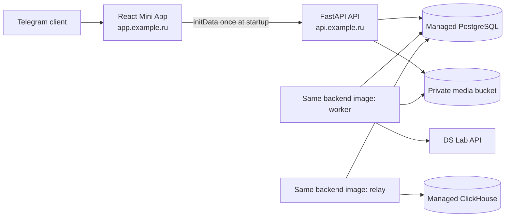

# План выпуска AI Matchmaker как Telegram Mini App

> **Статус:** план, инфраструктура и Telegram-интеграция ещё не созданы.
> **Обновлено:** 2026-09-02.
> **Цель:** invite-only closed beta в Москве для пользователей 21–35 лет.
> **Базовая архитектура:** существующий React SPA внутри Telegram, существующий FastAPI backend и Yandex Cloud. Отдельное мобильное приложение не создаётся.

## Статус выполнения

| Этап | Статус | Факт |
|---|---|---|
| 0. Launch gates | В работе | Auth/admission policy и technical retention defaults зафиксированы; legal review, Terms/Privacy, drills и budgets не завершены. |
| 1. Telegram authentication | В работе | Backend verifier, session endpoint, hashed invites, migration и PostgreSQL integration proof завершены; staging verification не завершена. |
| 2. React Mini App | В работе | Telegram bootstrap, auth handoff, safe-area/theme and Back Button integration implemented; real-client manual verification pending. |
| 3. Bot / Main Mini App | В работе | Separate staging bot token is configured locally; Main Mini App URL and smoke test await public staging HTTPS frontend. |
| 4. Deployable artifacts | В работе | One backend Docker image and Docker Compose runtime descriptor are added and build successfully; frontend release upload, registry/VM deployment and CI remain open. |
| 5–9. Staging, production, webhook | Не начаты | |

## 1. Что должно получиться

Пользователь открывает профиль Telegram-бота или direct link, нажимает **Open App** и попадает в Mini App внутри Telegram. Backend проверяет подписанные Telegram launch data, находит или создаёт application account и выдаёт существующую revocable opaque session. После этого все onboarding, recommendations, matches, messages, block/report и privacy endpoints работают без Telegram-specific логики.



Telegram отвечает только за доказательство владения Telegram account и запуск WebView. Postgres остаётся source of truth, а application session — единственным actor boundary для domain API.

## 2. Решения, принятые для этого плана

1. Использовать **Telegram Main Mini App**, а не отдельный mobile app, Telegram userbot или чатовый интерфейс вместо SPA.
2. Использовать Telegram identity как единственный пользовательский login для первой invite-only cohort. Дополнительный пользовательский auth provider не требуется.
3. После проверки `Telegram.WebApp.initData` выдавать существующую DB-backed application session. Это не второй login, а механизм TTL, logout, revocation и backend authorization.
4. Новый account создаётся только с валидным одноразовым invite из `start_param`. Invite — 32 random bytes в `base64url`, хранится только как `SHA-256` hash и истекает через 7 дней; отдельная подпись не нужна. Уже зарегистрированный Telegram user входит без нового invite.
5. Не создавать отдельный bot-service на первом этапе. Main Mini App работает без webhook. Webhook добавляется позже только для `/start`-ответа и уведомлений.
6. Оставить один backend artifact, запускаемый на одной Compute VM как `api`, `worker` и `relay`. Не добавлять Kubernetes, Redis/Celery, Kafka или domain microservices.
7. Разворачивать staging и production раздельно. Production PII не копируется в staging.

### Связанные auth contracts

[Authentication design](docs/authentication/design.md), API contract и задача `0.2` в [todos.md](todos.md) фиксируют тот же beta path:

> Первая invite-only cohort использует verified Telegram launch data + application session + controlled admission.

Telegram account не считается подтверждением возраста или уникального физического лица; эти риски закрываются age declaration, admission limits, rate limits, moderation и block/report controls.

## 3. Что уже есть и чего не хватает

### Уже есть

- React/Vite SPA и централизованный API client;
- `auth_identities(provider, provider_subject)` с unique constraint;
- opaque DB-backed sessions и единый `get_actor` для domain endpoints;
- FastAPI modules для onboarding, profiles, photos, recommendations, matches, messages, safety и privacy;
- Alembic migrations, DB-backed worker, transactional outbox и ClickHouse relay;
- S3-compatible media storage для Yandex Object Storage;
- `/healthz` и `/readyz`, structured logs и production configuration validation.

### Не хватает

- Telegram `initData` verifier и Telegram auth endpoint;
- invite-only admission для Telegram identities;
- Mini App bootstrap и Telegram-aware navigation в React;
- production mounting domain routers: сейчас при `APP_ENV != local` доступны только health endpoints;
- Docker image, VM process manifest и release procedure;
- созданных Yandex Cloud resources, DNS, TLS, secrets, alerts и backup/restore proof;
- production photo/message moderation и operator controls;
- production bot и его Main Mini App configuration.

## 4. Имена и входные данные

До начала работ зафиксировать значения в password manager или deployment inventory, не в Git:

| Значение | Пример-плейсхолдер | Где используется |
|---|---|---|
| Production bot username | `<prod_bot>` | BotFather, direct links |
| Staging bot username | `<staging_bot>` | безопасная проверка до production |
| Mini App short name | `<app_short_name>` | `t.me/<bot>/<short_name>` |
| Frontend domain | `app.<domain>` | Object Storage hosting, BotFather |
| API domain | `api.<domain>` | SPA config, TLS, CORS |
| Yandex staging folder | `<yc_staging_folder>` | отдельные staging resources |
| Yandex production folder | `<yc_prod_folder>` | отдельные production resources |
| Launch policy version | `<policy_version>` | обязательные consents |
| Initial cohort limit | `100` active accounts | admission kill switch |

Для production и staging использовать разных ботов и разные bot tokens. Так staging URL, тестовые сообщения и тестовые accounts не пересекаются с реальными пользователями.

## 5. Этап 0 — согласовать launch gates

**Статус: в работе.** Решения 1, 3–6 ниже зафиксированы. Legal review, Terms/Privacy, provider budgets и drills остаются launch blockers.

### Что сделать

1. Проверить согласованность [docs/authentication/design.md](docs/authentication/design.md), [docs/client-brief.md](docs/client-brief.md), API contract и `todos.md`: beta использует Telegram identity + invite-only admission.
2. Зафиксировать technical retention/export/deletion policy; до первого real-user invite получить legal review legal basis для РФ, Terms/Privacy и retention reports/audit/evidence.
3. Founder — единственный владелец moderation queue и incident response. Backup owner отсутствует и обязателен до public launch; для beta severe incident означает immediate kill switch, acknowledgement ≤30 min и containment ≤2 h.
4. Утвердить правила invite:
   - token случайный, одноразовый и с expiry;
   - token хранится в БД только как hash;
   - существующий account не требует новый invite;
   - share/replay использованного invite не создаёт второй account;
   - admission можно глобально остановить без остановки login существующих users.
5. Утвердить auth TTL. Рекомендуемый старт: `initData` не старше 5 минут, application session 24 часа; при следующем открытии Mini App session можно выпустить заново.
6. Не строить общий bot detector и SMS заранее. Пересмотреть дополнительную verification только при legal requirement, ≥3 confirmed ban-evasion incidents за 7 дней или coordinated-abuse evidence у ≥10% admitted accounts за 7 дней.

### Готово, когда

- один durable документ задаёт production auth contract;
- Telegram identity и invite admission являются единственным production login path;
- founder владеет safety gates; legal review reports/audit/evidence завершён до первого real-user invite;
- Telegram-only login не трактуется как подтверждение возраста, номера телефона или уникального человека.

## 6. Этап 1 — добавить Telegram authentication

**Статус: в работе.**

- [x] `POST /v1/auth/telegram/sessions`, server-side HMAC verification raw `initData`, 5-minute freshness и 24-hour session.
- [x] Hashed one-time invites, 7-day expiry, admission switch/cohort limit, Alembic migration и CLI `ai-matchmaker-invite`.
- [x] Local-password routes не монтируются вне `APP_ENV=local`; production mounts Telegram auth and domain routers.
- [x] Focused unit/config tests: valid HMAC shape, tamper/duplicate fields, stale/future `auth_date`, production config and route isolation.
- [x] PostgreSQL integration tests: new/existing identity, missing/reused invite и concurrent registration одного Telegram ID.
- [x] PostgreSQL cohort-cap и cross-account proof через Telegram-issued sessions.
- [ ] Applied migration and end-to-end auth verification in staging.

### Backend contract

Добавить endpoint:

```http
POST /v1/auth/telegram/sessions
Content-Type: application/json
Idempotency-Key: <uuid>

{"init_data":"<raw Telegram.WebApp.initData>"}
```

Успешный ответ остаётся совместимым с текущим frontend:

```json
{
  "account_id": "<uuid>",
  "session_token": "<opaque-token>",
  "expires_at": "<RFC3339 UTC>"
}
```

### Проверка `initData`

Реализовать небольшую stdlib-функцию на `urllib.parse`, `hmac`, `hashlib`, `json` и `time`; отдельная dependency не нужна. Алгоритм должен точно соответствовать Telegram documentation и официальному test vector.

Порядок проверки:

1. Принять только непустую строку ограниченного размера.
2. Parse query string и отклонить отсутствующие/повторяющиеся обязательные fields.
3. Извлечь `hash`, построить alphabetically sorted data-check string и проверить signature через `hmac.compare_digest`.
4. Проверить `auth_date`: не старше configured TTL и не находится недопустимо далеко в будущем.
5. Parse `user` как JSON и принять только положительный integer `id`; хранить Telegram subject как decimal string.
6. Не доверять `window.Telegram.WebApp.initDataUnsafe` и не принимать переданный клиентом `account_id`.
7. Не логировать raw `initData`, hash, username, name, photo URL или bot token.

### Account/session behavior

1. Найти `auth_identities(provider='telegram', provider_subject=<telegram_id>)`.
2. Если identity есть и account активен — выпустить новую application session.
3. Если identity нет — потребовать валидный, неиспользованный invite в `start_param`, создать account, Telegram identity, privacy defaults, onboarding event и audit row в одной transaction.
4. При concurrent first login unique constraint должен привести к одному account, а не к двум частично созданным accounts.
5. Deleted/banned account не пересоздаётся новым login.
6. Local login/password routes остаются доступны только при `APP_ENV=local` и loopback bind.
7. Production domain routers монтируются только вместе с production auth и required safety/config gates.

Потребуются новые server-only settings в `backend/src/ai_dating/config.py`, например bot token и `initData` max age. Bot token хранится только в Lockbox и никогда не становится `VITE_*` variable.

### Минимальное доказательство

Backend tests должны покрыть:

- корректную Telegram signature;
- tampered field и неверный hash;
- stale/future `auth_date`;
- malformed/missing user ID;
- existing login без invite;
- new account без invite и с reused invite;
- concurrent registration одного Telegram ID;
- local-password routes отсутствуют в staging/production;
- Telegram account A не получает ресурсы account B.

После реализации выполнить существующие проверки:

```bash
cd backend && uv run pytest -q
cd backend && uv run ruff check . && uv run ruff format --check .
```

## 7. Этап 2 — адаптировать React SPA под Mini App

**Статус: в работе.**

- [x] Official `telegram-web-app.js` подключён до app bundle; frontend использует native Web App API без npm SDK.
- [x] Bootstrap вызывает `ready()`/`expand()`, синхронизирует background/text theme values и respects Telegram safe-area CSS values.
- [x] Raw `initData` отправляется только в `/v1/auth/telegram/sessions`, не сохраняется; application session хранится в `sessionStorage`.
- [x] Login/register routes внутри Telegram redirect to bootstrap; Back Button возвращает на предыдущий route.
- [x] UI states: missing launch data, stale/invalid launch, unavailable invite and backend/network failure.
- [ ] Manual verification on iOS, Android and Telegram Desktop after staging bot and HTTPS URLs are available.

### Что сделать

1. Подключить официальный Telegram Web App script в `frontend/index.html`; не добавлять npm SDK только ради нескольких API calls.
2. Создать маленький `frontend/src/lib/telegram.ts`, который:
   - обнаруживает `window.Telegram?.WebApp`;
   - возвращает raw `initData`;
   - вызывает `ready()` после bootstrap;
   - вызывает `expand()` при поддержке клиентом;
   - предоставляет Back Button integration для React Router;
   - синхронизирует только необходимые theme/safe-area values.
3. При старте внутри Telegram вызвать `/v1/auth/telegram/sessions`, сохранить application session в memory/session storage и перейти:
   - новый account → `/onboarding`;
   - незавершённый account → текущий onboarding state;
   - активный account → `/recommendations`.
4. Не показывать `/login` и `/register` внутри Telegram. В local browser они сохраняются для разработки.
5. Не хранить raw `initData` после завершения login и не отправлять его ни в analytics, ни в error telemetry.
6. Обработать четыре понятных состояния: запуск вне Telegram, invalid/stale launch, admission closed/invalid invite, временно недоступный backend.
7. Проверить viewport с экранной клавиатурой, safe areas, тёмную тему, системный Back Button, upload photo и conversation на iOS, Android и Telegram Desktop.

Frontend продолжает использовать существующие `api`, `http` и `session` modules. Новый global state manager и отдельный Telegram frontend не нужны.

### Как проверить

```bash
cd frontend && pnpm lint && pnpm tsc --noEmit && pnpm build
```

Manual checks:

- local browser login всё ещё работает только в local environment;
- Telegram staging bot автоматически создаёт session;
- refresh/reopen восстанавливает пользователя через новый Telegram bootstrap;
- expired application session не оставляет blank screen;
- navigation/back/upload работают в трёх основных Telegram clients.

## 8. Этап 3 — настроить Telegram bot и Main Mini App

**Статус: в работе.**

- [x] Separate staging bot token configured locally as `TELEGRAM_BOT_TOKEN`.
- [ ] Main Mini App URL, app short name, staging `startapp` smoke test and public bot profile configuration await staging HTTPS frontend.

### Staging bot

1. Создать отдельного bot через `@BotFather`.
2. Задать name, username, avatar, short description и description без обещаний, которых ещё нет в продукте.
3. В BotFather включить Main Mini App и создать app short name.
4. Указать staging HTTPS URL Mini App.
5. Добавить preview screenshots/video только после проверки актуального UI.
6. Создать direct link с `startapp=<one-time-invite>` для первого internal user.
7. Проверить, что Open App доступен из bot profile и direct link открывает тот же origin.

### Production bot

Повторить настройку с production token и URL только после прохождения staging gates. Перед первыми приглашениями проверить:

- bot username и branding;
- Terms, Privacy и support contact;
- отсутствие test links и test descriptions;
- production `startapp` invite создаёт ровно один account;
- обычная ссылка без invite не создаёт новый account;
- существующий user может войти через bot profile без invite.

Main Mini App не требует webhook. Не добавлять webhook, пока нет пользовательской функции, которая без него не работает.

## 9. Этап 4 — подготовить deployable artifacts

**Статус: в работе.**

- [x] Один locked backend image с non-root runtime user; из него запускаются API, worker и relay.
- [x] Docker Compose выбран как единственный VM runtime manifest; processes have restart policy and graceful stop period.
- [x] One-shot `alembic upgrade head` доступен из того же image и запускается до promotion.
- [x] Image build and Compose rendering verified locally.
- [ ] Build/upload immutable frontend artifact with the target `VITE_API_BASE_URL`.
- [ ] Tag/push image by Git commit SHA, deploy it to VM and add CI.

Репозиторий пока не содержит Dockerfile, Compose/systemd manifest или CI. До provision production добавить минимальную упаковку:

1. Один immutable backend image с locked `uv` dependencies и non-root runtime user.
2. Из того же image запускать три process commands:
   - API: `uv run ai-matchmaker`;
   - worker: `uv run ai-matchmaker-worker`;
   - relay: `uv run ai-matchmaker-relay`.
3. Один VM manifest, который фиксирует image digest, restart policy, health check, resource limits и graceful stop для трёх процессов.
4. One-shot migration command, запускаемый оператором ровно один раз до promotion. API startup не запускает Alembic.
5. Frontend artifact — содержимое `frontend/dist`, построенное с production `VITE_API_BASE_URL`.
6. Release ID — Git commit SHA; он одинаков для API, worker, relay и observability metadata.
7. Rollback — предыдущий image digest и предыдущий frontend artifact. Schema после migration откатывается только совместимым code rollback или forward-fix.

Рекомендуемый минимальный runtime на одной VM — Docker Compose или три systemd units вокруг одного image. Выбрать один механизм в `TBD-INF03`; не поддерживать оба.

## 10. Этап 5 — создать Yandex Cloud staging

**Статус: не начат.**

Создать отдельный staging folder и inventory всех resource IDs. Начальный размер — предположение для low-volume beta, его нужно менять по метрикам, а не заранее строить autoscaling.

### IAM и сеть

1. Создать VPC и subnet.
2. Создать runtime service account для VM с минимальными правами:
   - pull конкретного Container Registry repository;
   - read конкретных Lockbox secrets;
   - доступ только к нужному media bucket;
   - запись logs/metrics.
3. Отдельно дать migration operator доступ к direct database URL; runtime processes не должны иметь DDL privileges.
4. Security groups:
   - Internet → reverse proxy: только `443` и временно `80` для certificate issuance/redirect;
   - administration: `22` только с approved operator IP либо через выбранный controlled access path;
   - VM → PostgreSQL/ClickHouse/Object Storage/model providers: только необходимые destinations/ports;
   - PostgreSQL не имеет общего public ingress.

### PostgreSQL

1. Создать Managed PostgreSQL в private network с provider backups/PITR.
2. Создать отдельные runtime и migration credentials.
3. Включить требуемые `pgvector`/PostGIS extensions и проверить их versions в staging migration.
4. Сохранить runtime/direct URLs в Lockbox.
5. Настроить connection limits с запасом для API, worker и relay; не отдавать весь DB limit application pool.

### Object Storage

Создать два разных bucket:

- **frontend bucket** — public read, содержит только hashed SPA assets и `index.html`;
- **media bucket** — private, содержит originals, approved derivatives, moderation evidence и exports.

Для frontend bucket:

1. Имя должно соответствовать frontend FQDN при использовании custom-domain hosting.
2. Включить static website hosting и SPA fallback на `index.html`.
3. Подключить HTTPS certificate и DNS.
4. Установить короткий cache TTL для `index.html` и длинный immutable cache для hashed assets.

Для media bucket:

1. Запретить public listing/read.
2. Разрешить direct upload только через scoped short-lived signed URLs.
3. CORS allowlist содержит только Mini App origin и необходимые methods/headers.
4. Настроить cleanup abandoned upload intents/expired exports после утверждения retention policy.

### Compute VM и API TLS

1. Создать одну Compute VM, стартово порядка 2 vCPU / 4 GB RAM, с non-preemptible disk и attached runtime service account.
2. Установить только container runtime и один reverse proxy.
3. Reverse proxy завершает HTTPS для `api.<domain>`, добавляет request limits/timeouts и проксирует на API, слушающий localhost/private interface.
4. Не публиковать worker, relay, PostgreSQL или ClickHouse ports.
5. Разрешить VM получить Lockbox payload через service account; не помещать secret values в cloud-init/user-data или image.

### ClickHouse и providers

1. Создать Managed ClickHouse с ingest-only credential для relay.
2. Инициализировать versioned raw events schema существующим `ai-matchmaker-ch-init` после добавления production command/runbook.
3. Сохранить DS Lab и ClickHouse credentials в Lockbox.
4. Оставить `RERANK_ENABLED=false`, пока evaluation manifest не разрешает конкретные model/prompt/projection versions.

## 11. Этап 6 — первый staging deployment

**Статус: не начат.**

Выполнять в таком порядке:

1. Прогнать все repository checks локально.
2. Собрать backend image, присвоить release ID и отправить в Yandex Container Registry.
3. Просканировать image; исправить critical/high findings либо зафиксировать approved exception с expiry.
4. Собрать frontend с staging API URL и загрузить immutable assets, затем `index.html`.
5. Создать/update Lockbox secret version с staging config.
6. Проверить backup freshness PostgreSQL до migration.
7. Запустить `cd backend && uv run alembic upgrade head` как один migration job с direct URL.
8. Проверить current Alembic revision и явные extensions/indexes/grants.
9. Запустить API и дождаться успешных `/healthz` и `/readyz`.
10. Запустить worker, затем relay из того же image digest.
11. Настроить staging bot Main Mini App URL.
12. Создать один staging invite и пройти полный путь двумя accounts до reciprocal match/message/block.

### Обязательные staging проверки

- altered/stale Telegram `initData` получает generic `401`, без внутренних деталей;
- invalid/reused invite не создаёт account;
- local-password endpoints и local profile directory отсутствуют;
- original photo не public, candidate получает только approved derivative;
- recommendation delivery повторно проверяет reciprocal eligibility, block и moderation;
- block немедленно скрывает обе стороны;
- AI/embedding outage даёт документированный fallback, но не ослабляет hard filters;
- ClickHouse outage увеличивает outbox lag, но не приводит к dual-write/data loss;
- restart API/worker/relay не создаёт duplicate match/event/job effects;
- logs не содержат `initData`, session tokens, Telegram ID, DOB/location, message/profile text и signed URLs;
- backup restore drill восстанавливает staging в отдельный target и проходит invariant checks.

## 12. Этап 7 — observability и release safety

**Статус: не начат.**

До production настроить dashboard и alerts минимум для:

- API availability, error rate и p95 latency;
- PostgreSQL connections/storage/backup freshness;
- oldest job age, attempts и terminal failures;
- recommendation generation latency и fallback rate;
- outbox depth/age и ClickHouse delivery failures;
- moderation queue age и severe reports;
- object cleanup/deletion/export failures;
- provider latency, rate limits и daily cost guardrails;
- auth failures и invite consumption rate в агрегированном виде.

Alerts должны иметь notification channel, owner и runbook action. `No data` для API/jobs/outbox нельзя считать успешным состоянием.

Проверить safe-mode switches, которые независимо останавливают:

1. новые admissions;
2. recommendation generation/delivery;
3. новые messages;
4. model calls;
5. profile visibility по incident scope.

Core block/report/security writes не отключаются общим kill switch.

## 13. Этап 8 — production deployment

**Статус: не начат.**

1. Создать отдельный production folder и повторить staging topology; не клонировать staging database или secrets.
2. Настроить production DNS/TLS и проверить HTTPS до передачи URL в BotFather.
3. Создать production Lockbox secrets и credentials с минимальными roles.
4. Включить provider-managed backups и подтвердить restore procedure.
5. Развернуть ровно тот image digest и frontend artifact, которые прошли staging.
6. Запустить migration job один раз, затем API → worker → relay.
7. Проверить `/healthz`, `/readyz`, process status, DB migration revision, job/outbox lag и отсутствие unexpected logs.
8. Привязать production Mini App URL в production bot.
9. Выполнить internal smoke test с synthetic/internal accounts.
10. Открыть admissions только для первой маленькой cohort; рекомендуемый первый шаг — 10–20 users, затем до 100 после проверки safety и supply.
11. Останавливать rollout при любой hard-filter/block/privacy leak, неукомплектованной moderation queue или недостаточном reciprocal supply.

### Rollback

Если release ломает UI/API без schema incompatibility:

1. Закрыть новые admissions.
2. При safety risk отключить recommendation delivery/messages соответствующим safe-mode switch.
3. Вернуть предыдущий backend image digest.
4. Вернуть предыдущий frontend artifact и `index.html`.
5. Проверить readiness, session login и одну безопасную domain operation.
6. Schema не откатывать destructive migration; выполнить заранее подготовленный forward-fix.

Если скомпрометирован bot token:

1. Закрыть admissions и Telegram auth.
2. Отозвать token через BotFather.
3. Создать новую Lockbox secret version и redeploy API.
4. Отозвать активные application sessions, если есть риск утечки launch data/session tokens.
5. Проверить audit/logs и документировать incident.

## 14. Этап 9 — webhook и уведомления после базового запуска

**Статус: не начат; deliberately deferred.**

Добавлять только если подтверждена необходимость Telegram notifications или `/start` UX.

### Минимальный webhook

1. Добавить один FastAPI endpoint с secret path/header validation.
2. В Bot API вызвать `setWebhook` с HTTPS URL, `secret_token` и минимальным `allowed_updates`.
3. Дедуплицировать processing по Telegram `update_id`.
4. `/start` отвечает коротким текстом и кнопкой Open App; account создаётся только через проверенный Mini App `initData`, не из chat update.
5. Notification worker использует существующий outbox/job pattern и idempotency key, а не выполняет Bot API call внутри domain transaction.
6. Сообщения должны быть generic: «Подборка готова» или «У вас новый match». Не включать имя, фото, location, private facts, report/block/moderation detail или message body.
7. Хранить user opt-in/opt-out и Telegram delivery status; permanent bot block прекращает retries.

Не создавать отдельный bot microservice, пока webhook/notification throughput не требует независимого scaling/SLO.

## 15. Definition of done для первой Telegram closed beta

### Product

- Main Mini App открывается из production bot profile и invite direct link.
- Новый invited user проходит Telegram login и onboarding без отдельных credentials.
- Existing user повторно входит без invite.
- До пяти рекомендаций проходят reciprocal hard filters и safety checks до ranking и перед delivery.
- Like/pass, reciprocal match, messages, unmatch, block и report работают на mobile Telegram clients.

### Security/privacy

- Backend проверяет signature и freshness raw `initData`; client-side Telegram fields сами по себе ничего не авторизуют.
- Один Telegram ID связан максимум с одним active account; invite расходуется один раз.
- Sessions revocable; deleted/banned account не пересоздаётся автоматически.
- Secrets находятся в Lockbox; private media bucket не public.
- Logs/traces/events не содержат sensitive payload или Telegram credentials.
- Terms/Privacy, export/deletion и moderation workflow прошли утверждённые beta gates.

### Operations

- Staging и production разделены.
- Release воспроизводим по immutable image digest и frontend artifact.
- Migration запускается отдельно до application promotion.
- Alerts доставляются живому owner; backup restore и rollback проверены.
- У operator есть kill switches и runbooks для auth, recommendations, messages, model/provider и privacy incidents.

### Проверки репозитория

```bash
cd backend && uv run pytest -q
cd backend && uv run ruff check . && uv run ruff format --check .
cd frontend && pnpm lint && pnpm tsc --noEmit && pnpm build
```

## 16. Что сознательно не входит в первую версию

- дополнительные user login providers и MFA для обычных users;
- собственный ML bot detector, device fingerprinting и CAPTCHA;
- Telegram chat как место хранения matches/messages;
- отдельный native mobile app;
- payments, Telegram Stars, subscriptions и boosts;
- push campaigns, referral platform и bot analytics framework;
- Kubernetes, autoscaling group, multi-region, Redis/Celery, Kafka и microservices;
- learned ranker и realtime feature store.

Добавлять anti-abuse verification нужно после измеримого обхода invite/bans/rate limits. Добавлять webhook — после необходимости уведомлений. Добавлять второй VM/managed orchestration — после resource saturation или требования независимого SLO.

## 17. Официальные источники

- [Telegram Mini Apps documentation](https://core.telegram.org/bots/webapps)
- [Telegram Main Mini Apps](https://core.telegram.org/api/bots/webapps)
- [Telegram Bot API: `setWebhook`](https://core.telegram.org/bots/api#setwebhook)
- [Telegram Terms of Service for Bot Developers](https://telegram.org/tos/bot-developers)
- [Yandex Cloud: Managed PostgreSQL connections](https://yandex.cloud/en/docs/managed-postgresql/operations/connect)
- [Yandex Cloud: Object Storage custom domain and HTTPS](https://yandex.cloud/en/docs/storage/operations/hosting/own-domain)
- [Yandex Cloud: Container Registry](https://yandex.cloud/en/docs/container-registry/)
- [Yandex Cloud: Lockbox](https://yandex.cloud/en/docs/lockbox/concepts/)
- [Yandex Cloud: VM access to Lockbox secrets](https://yandex.cloud/en/docs/compute/operations/vm-create/create-with-lockbox-secret)
- [Yandex Cloud Monitoring alerts](https://yandex.cloud/en/docs/monitoring/concepts/alerting/alert)
