# Data model

> **Status:** Proposed. PostgreSQL-oriented logical schema; migration files do not yet exist.  
> **Conventions:** UUID PK generated by server/DB, `timestamptz` in UTC, `snake_case`, money absent, enums implemented as constrained `text` until values stabilize.

## 1. Ownership and data classes

For local prototype, the application auth module owns local-password identities, password hashes and revocable sessions in Postgres; closed beta adds verified Telegram identities and reuses the same sessions. `accounts.account_id` is an application UUID and never comes from the client or an external provider. Postgres is authoritative for domain state. Object storage owns media bytes. `profile_embeddings`, unconfirmed AI facts, scores and analytical marts are derived.

| Class | Examples | Controls |
|---|---|---|
| Restricted PII | DOB, phone, precise/coarse point, external identity, device/IP audit | Separate table/grants, no application logs, encryption in transit/at rest |
| Sensitive profile | Orientation, gender identity, desired partner, private facts | Owner + matching policy only; field-level visibility |
| Sensitive communication | Message bodies, report details and moderation evidence | Conversation/case-scoped authorization, restricted staff role, no analytics/log payload, encryption in transit/at rest |
| Public-to-eligible | Approved profile name, age, area, prompts, approved photos | Returned only after eligibility and visibility checks |
| Security data | Blocks, reports, moderation evidence, staff access audit | Restricted role, append-only audit, separate retention |
| Derived | Embeddings, rank features/scores, generated reasons | Rebuildable/versioned; delete with source account |

`deleted_at` means soft-deleted and immediately unavailable to product queries. Hard deletion follows the retention policy in [privacy-safety.md](privacy-safety.md). Security evidence may be retained separately when legally justified; it must not resurrect a public profile.

MVP relies on managed database/storage encryption at rest plus TLS and least-privilege grants. Application-level column encryption is **TBD-SEC04** only if the launch threat model or jurisdiction requires separation from database operators; adding it without key-management/lookup requirements would not improve the current design.

## 2. Entity relationship diagram

```mermaid
erDiagram
    ACCOUNTS ||--o{ AUTH_IDENTITIES : authenticates
    ACCOUNTS ||--o{ AUTH_SESSIONS : opens
    ACCOUNTS ||--|| AUTH_PASSWORD_CREDENTIALS : secures
    ACCOUNTS ||--|| PROFILES : owns
    ACCOUNTS ||--|| DATING_PREFERENCES : owns
    ACCOUNTS ||--|| PRIVACY_CONTROLS : owns
    PROFILES ||--o{ PROFILE_PHOTOS : has
    PROFILES ||--o{ PROFILE_ANSWERS : has
    PROFILES ||--o{ PROFILE_FACTS : has
    PROFILES ||--o{ PROFILE_EMBEDDINGS : derives
    ACCOUNTS ||--o{ CONSENTS : grants
    ACCOUNTS ||--o{ ONBOARDING_STEP_COMPLETIONS : completes
    ACCOUNTS ||--o{ CALIBRATION_SESSIONS : runs
    CALIBRATION_SESSIONS ||--o{ CALIBRATION_CHOICES : contains
    ACCOUNTS ||--o{ BLOCKS : creates
    ACCOUNTS ||--o{ REPORTS : files
    REPORTS ||--o| MODERATION_CASES : opens
    ACCOUNTS ||--o{ RECOMMENDATION_BATCHES : owns
    RECOMMENDATION_BATCHES ||--o{ RECOMMENDATION_ITEMS : contains
    RECOMMENDATION_ITEMS ||--o| RECOMMENDATION_EXPOSURES : exposes
    RECOMMENDATION_ITEMS ||--o{ RECOMMENDATION_ACTIONS : receives
    ACCOUNTS ||--o{ LIKES : sends
    ACCOUNTS ||--o{ MATCHES : joins
    MATCHES ||--|| CONVERSATIONS : opens
    CONVERSATIONS ||--o{ CONVERSATION_MEMBERS : has
    CONVERSATIONS ||--o{ MESSAGES : contains
    ACCOUNTS ||--o{ EXPERIMENT_ASSIGNMENTS : receives
    ACCOUNTS ||--o{ IDEMPOTENCY_KEYS : scopes
```



## 3. Core identity and profile tables

### `accounts`

Назначение: application identity и lifecycle. Identity proof хранится отдельно и может меняться без изменения `account_id`.

| Field | Type | Null/default | Constraints / indexes |
|---|---|---|---|
| `account_id` | `uuid` | not null | PK, server-generated |
| `status` | `text` | `onboarding` | check `onboarding, active, paused, suspended, deletion_pending, deleted` |
| `date_of_birth` | `date` | null | restricted PII; check `status = onboarding OR date_of_birth IS NOT NULL`; service validates age because a current-date age rule is not an immutable DB check |
| `last_active_at` | `timestamptz` | now | index for activity eligibility |
| `onboarding_completed_at` | `timestamptz` | null | set once after user-controlled completion gates |
| `created_at`, `updated_at` | `timestamptz` | now | `updated_at >= created_at` |
| `deleted_at` | `timestamptz` | null | required when status is `deleted`/`deletion_pending` |

Queries: load current actor; active cutoff scan; deletion queue.

For local prototype, one transaction creates account, `local_password` identity, password credential and revocable session. Closed-beta admission creates a `telegram` identity from verified Mini App launch data. Deletion revokes sessions first and erases domain data before deleting auth identities; credentials never own domain lifecycle.

### Authentication tables

Полный contract находится в [authentication design](../authentication/design.md). `auth_identities` связывает уникальный `(provider, provider_subject)` с account; local provider `local_password` хранит normalised login, beta provider — decimal Telegram user ID. `auth_password_credentials` хранит Argon2id hash, а `auth_sessions` только token hash, expiry и revocation. `auth_invites` не создаётся в local prototype; beta хранит `token_hash`, `expires_at`, `used_at` и `admitted_account_id`, поэтому plaintext invite нельзя извлечь из БД.

Invariant: local password auth не запускается вне local loopback; plaintext password не хранится и не попадает в logs/events.

The user-controlled completion transaction sets `onboarding_completed_at` and transitions `accounts.status` from `onboarding` to `active`. Dating discoverability still requires separate `profiles.activated_at`, approved moderation and current privacy/safety gates.

### `profiles`

Назначение: dating profile и visibility. `area_code` is restricted beta data and is not sent to candidates. `location` exists only for a separately approved future distance policy.

| Field | Type | Null/default | Constraints / indexes |
|---|---|---|---|
| `profile_id` | `uuid` | DB UUID | PK |
| `account_id` | `uuid` | not null | unique FK `accounts` on delete cascade |
| `display_name` | `text` | not null | length 1..80 |
| `bio` | `text` | null | length ≤2000 |
| `gender_code`, `orientation_code` | `text` | not null | controlled vocabulary; sensitive |
| `search_mode` | `text` | not null | check `dating, friendship`; beta policy permits `dating` only |
| `relationship_goal_code` | `text` | null | required when `search_mode=dating`; null when `friendship` in prototype only |
| `relationship_status` | `text` | `single` | MVP check `single` |
| `city_code` | `text` | `moscow` | MVP city hard filter |
| `location` | `geography(Point,4326)` | null | future exact-distance policy only; beta does not collect or synthesize a point |
| `area_code` | `text` | not null | restricted coarse Moscow area selected in onboarding; never serialized to another user in beta |
| `visibility` | `text` | `hidden` | check `hidden, eligible, paused` |
| `moderation_state` | `text` | `pending` | check `pending, approved, rejected, suspended` |
| `activated_at` | `timestamptz` | null | set when all server-controlled visibility/generation gates first pass |
| `completion_percent` | `smallint` | 0 | check 0..100 |
| `version` | `integer` | 1 | positive; increment on rank-relevant change |
| `created_at`, `updated_at`, `deleted_at` | `timestamptz` | now/now/null | index `(visibility, moderation_state, updated_at)` |

Queries: reciprocal candidate filtering; profile owner edit; public projection after authorization. Beta uses Moscow city equality and does not expose or filter by distance. A later exact-distance policy requires an explicit location/retention review; silent centroid or approximate distance is forbidden.

Every change to candidate-facing fields, answer/photo membership/order/moderation or approved derivative increments `profiles.version`. This makes the public projection version a delivery guard, not only a ranking hint.

### `profile_photos`

Назначение: media metadata; no binaries in Postgres.

| Field | Type | Null/default | Constraints / indexes |
|---|---|---|---|
| `photo_id` | `uuid` | DB UUID | PK |
| `profile_id` | `uuid` | not null | FK `profiles` cascade |
| `object_key` | `text` | not null | unique; private bucket key |
| `derived_object_key` | `text` | null | unique when present |
| `position` | `smallint` | not null | check -1..5 (`-1` is in-transaction reorder parking only; API slots are 0..5), partial unique `(profile_id, position) WHERE deleted_at IS NULL` |
| `moderation_state` | `text` | `pending` | check `pending, approved, rejected` |
| `content_hash` | `text` | not null | index for duplicate abuse detection |
| `width`, `height` | `integer` | null | both positive when known |
| `created_at`, `moderated_at`, `deleted_at` | `timestamptz` | now/null/null | index `(profile_id, moderation_state)` |

Queries: ordered approved photos; pending moderation; deletion cleanup. Clients receive expiring signed URLs, never `object_key`.

### `profile_answers`

Назначение: reviewed answers to curated prompts.

| Field | Type | Null/default | Constraints / indexes |
|---|---|---|---|
| `answer_id` | `uuid` | DB UUID | PK |
| `profile_id` | `uuid` | not null | FK `profiles` cascade |
| `prompt_code` | `text` | not null | partial unique `(profile_id, prompt_code) WHERE deleted_at IS NULL` |
| `answer_text` | `text` | not null | length 1..1000 |
| `visibility` | `text` | `eligible_only` | check `private, matching_only, eligible_only` |
| `version` | `integer` | 1 | positive |
| `created_at`, `updated_at`, `deleted_at` | `timestamptz` | now/now/null | partial index on active rows |

Queries: edit answer; build profile/embedding projection according to visibility.

### `dating_preferences`

Назначение: desired partner and reciprocal hard-filter inputs, separate from self profile.

| Field | Type | Null/default | Constraints / indexes |
|---|---|---|---|
| `account_id` | `uuid` | not null | PK/FK `accounts` cascade |
| `search_mode` | `text` | not null | same as self; reciprocal eligibility requires equal modes |
| `accepted_gender_codes` | `text[]` | not null | non-empty; API name kept (spec: `preferred_gender_codes`) |
| `age_min`, `age_max` | `smallint` | not null | schema supports 18..120; beta policy validates both values inside 21..35 |
| `max_distance_km` | `smallint` | null | future distance policy; null and unused in beta |
| `city_codes` | `text[]` | not null | non-empty; MVP `moscow` |
| `relationship_goal_codes` | `text[]` | not null | non-empty for beta `dating`; `friendship` semantics are prototype-only |
| `dealbreakers` | `jsonb` | `{}` | allowed-key/schema validation in API; no arbitrary SQL interpretation |
| `version` | `integer` | 1 | positive, increment on change |
| `created_at`, `updated_at` | `timestamptz` | now | index `updated_at` for invalidation |

Queries: eligibility in both directions; recommendation invalidation. GIN may be added only after `EXPLAIN` shows array predicates need it; narrow-market retrieval starts from active approved profiles.

### `profile_facts`

Назначение: normalized user claims from form or AI extraction, with correction and provenance.

| Field | Type | Null/default | Constraints / indexes |
|---|---|---|---|
| `fact_id` | `uuid` | DB UUID | PK |
| `profile_id` | `uuid` | not null | FK `profiles` cascade |
| `profile_side` | `text` | not null | check `self, desired_partner` |
| `fact_code` | `text` | not null | closed vocabulary in [ai-ml.md](ai-ml.md) |
| `value` | `text` | not null | closed slug for that `fact_code` |
| `preference_strength` | `text` | null | null on `self`; `dont_care, prefer, strong_preference` on `desired_partner` |
| `source_type` | `text` | not null | check `form, free_text, user_edit` (events: `explicit`/`ai_extracted` mapped as `user_entered`/`extracted`) |
| `source_id` | `uuid` | null | answer/extraction job when applicable |
| `provenance_excerpt` | `text` | null | minimized; never public |
| `confidence` | `numeric(4,3)` | null | check 0..1; null for direct form/user edit |
| `review_state` | `text` | `pending` | check `pending, confirmed, rejected` |
| `visibility` | `text` | `private` | check `private, matching_only, eligible_only`; accept sets `matching_only` |
| `valid_from`, `reviewed_at`, `superseded_at` | `timestamptz` | now/null/null | one active fact per `(profile_id, profile_side, fact_code, value)` via partial unique index |
| `extractor_version` | `text` | null | required for `free_text`; equals prompt version |
| `prompt_version` | `text` | null | captured extraction prompt |
| `model_version` | `text` | null | captured provider model |
| `superseded_by_id` | `uuid` | null | FK `profile_facts`; lineage for user edits |

Queries: pending review; current confirmed facts; model evaluation by version. AI output stays `pending` until explicit review. Matching reads only `review_state=confirmed` and `visibility` in `matching_only|eligible_only`.

`fact_code` allowlist and closed values are defined in [ai-ml.md](ai-ml.md) extraction schema v2. Repeatable codes may have multiple active rows; ordinal codes have at most one active value per `(profile_id, profile_side)`.

### `profile_embeddings`

Назначение: derived vector for candidate retrieval; rebuildable.

| Field | Type | Null/default | Constraints / indexes |
|---|---|---|---|
| `embedding_id` | `uuid` | DB UUID | PK |
| `profile_id` | `uuid` | not null | FK `profiles` cascade |
| `kind` | `text` | not null | check `self, desired_partner` |
| `source_version` | `integer` | not null | profile/preferences version snapshot |
| `model_version` | `text` | not null | exact provider/model/config key |
| `embedding` | `vector(768)` | not null | cosine retrieval; DS Lab `gte-base` |
| `created_at` | `timestamptz` | now | unique `(profile_id, kind, source_version, model_version)` |

**Decision:** retrieval uses DS Lab `gte-base` (`vector(768)`) with the same `DSLAB_API_KEY` as extraction and reranking. The exact model ID is stored in `model_version`. A model or dimension change requires a new column/table migration and parallel backfill; vectors of different model/dimension are never mixed in one index.

## 4. Onboarding and calibration state

### `onboarding_step_completions`

Canonical funnel state without raw answers: `account_id uuid FK`, `flow_version text`, `step_code text`, `completed_at timestamptz`, `profile_version integer null`, `preferences_version integer null`; composite PK `(account_id,flow_version,step_code)`. A step PATCH inserts with `ON CONFLICT DO NOTHING` and emits `onboarding_step_completed` only when the row is new. `step_code` is an allowlist tied to `flow_version`.

### `calibration_sessions`

`calibration_session_id uuid PK`, `account_id uuid FK`, `calibration_version text`, `state text CHECK(started,completed,skipped)`, `synthetic_only boolean default true`, `signal_snapshot jsonb default '{}'`, `started_at`, `completed_at`; unique `(account_id,calibration_version)`. Prototype `calibration_version` is `v1` with five text-only synthetic pairs. `signal_snapshot` is derived, contains only versioned soft-feature weights and is deleted when calibration consent/data is cleared; it is not a beta activation dependency.

### `calibration_choices`

`calibration_choice_id uuid PK`, `calibration_session_id uuid FK`, `demo_pair_id text`, `selection text CHECK(left,right,neither)`, `reason_code text null`, `created_at`; unique `(calibration_session_id,demo_pair_id)`. Demo IDs are opaque `demo-v1-*` strings, never account/profile UUIDs. There are no FKs to real profiles, and these rows never create recommendation actions or canonical like/pass events. Optional `reason_code`: `shared_interests`, `communication_style`, `activity_style`, `schedule_fit`, `other`.

## 5. Consent, safety and privacy tables

### `consents`

Append-only consent receipt: `consent_id uuid PK`, `account_id uuid FK`, `purpose text`, `policy_version text`, `decision text CHECK(granted,rejected,withdrawn)`, `occurred_at timestamptz`, `source text`, `evidence_hash text`. Index `(account_id,purpose,occurred_at desc)`; API idempotency prevents duplicate receipts. Current consent is the latest receipt, not an overwritten boolean.

### `privacy_controls`

One row per account: `account_id uuid PK/FK`, `discoverable boolean default false`, `show_distance boolean default false`, `allow_ai_matching boolean default false`, `allow_product_analytics boolean default false`, `updated_at timestamptz`. No nullable fields. Query on every visibility transition; no public read.

### `blocks`

`block_id uuid PK`, `blocker_account_id` and `blocked_account_id` FKs, `reason_code text null`, `created_at timestamptz`, `ended_at timestamptz null`; check actors differ. Partial unique index on `(blocker_account_id, blocked_account_id) WHERE ended_at IS NULL`, plus reverse lookup index. A block is enforced symmetrically even though ownership remains with blocker.

### `reports`

`report_id uuid PK`, `reporter_account_id` FK, `subject_account_id` FK, optional `message_id` FK, `reason_code text`, `details text null` length ≤4000, `state text default open CHECK(open,triaged,resolved,dismissed)`, `created_at`, `resolved_at`; check actors differ. Index `(state,created_at)` for queue and `(subject_account_id,created_at)` for abuse patterns. Report creation also creates/maintains a block in one transaction.

### `moderation_cases`

`case_id uuid PK`, optional `report_id` unique FK, `subject_account_id` FK, `source text CHECK(report,automated,staff)`, `severity text`, `state text CHECK(open,reviewing,resolved)`, `decision text null`, `assigned_staff_id uuid null`, `evidence_object_key text null`, `created_at`, `updated_at`, `resolved_at`. Index `(state,severity,created_at)`. Evidence bucket and staff identity are restricted; decision changes emit security audit.

### `security_audit_log`

Append-only: `audit_id uuid PK`, `action text`, `actor_type text`, `actor_id uuid null`, `subject_account_id uuid null`, `resource_type text`, `resource_id uuid null`, `request_id text`, `metadata jsonb` minimized, `occurred_at timestamptz`. Indexes on `(subject_account_id,occurred_at)` and `(action,occurred_at)`. UPDATE/DELETE denied to application role.

## 6. Recommendation and interaction tables

### `recommendation_batches`

| Field | Type | Null/default | Constraints / indexes |
|---|---|---|---|
| `recommendation_batch_id` | `uuid` | DB UUID | PK |
| `owner_account_id` | `uuid` | not null | FK `accounts` |
| `status` | `text` | `building` | check `building,ready,served,expired,failed` |
| `generation_key` | `text` | not null | unique; idempotent job output |
| `batch_schema_version` | `integer` | 1 | positive; serialized batch contract version |
| `input_snapshot` | `jsonb` | not null | versions/IDs, not unrestricted PII |
| `eligibility_version`, `ranker_version`, `prompt_version`, `model_version` | `text` | not null/null | `prompt/model` nullable when no LLM |
| `fallback_mode` | `text` | `none` | check `none,no_llm,no_embedding,insufficient_supply` |
| `batch_kind` | `text` | `normal` | check `normal,exploratory`; exploratory is user-requested only and still fully eligible |
| `candidate_count`, `item_count` | `integer` | 0 | non-negative; item_count ≤5 |
| `created_at`, `ready_at`, `expires_at` | `timestamptz` | now/null/not null | index `(owner_account_id,status,expires_at desc)` |

### `recommendation_items`

`recommendation_item_id uuid PK`, `recommendation_batch_id uuid FK`, `candidate_account_id uuid FK`, `item_schema_version integer default 1 CHECK >0`, `rank smallint CHECK 1..5`, component scores as `numeric(6,5)` nullable, `final_score numeric(6,5)`, `public_profile_snapshot jsonb`, `reason_snapshot jsonb`, `candidate_profile_version integer`, `candidate_embedding_version text null`, `created_at timestamptz`. Unique `(batch_id,candidate_account_id)` and `(batch_id,rank)`; index `candidate_account_id`. The public snapshot contains only display-approved scalar fields, answer/photo IDs + versions and display age; it never stores coordinates, private facts, object keys or signed URLs. Reasons contain only eligible/public fields and versioned reason codes/text.

### `recommendation_exposures`

Authoritative anti-repetition record: `exposure_id uuid PK`, `owner_account_id`, `candidate_account_id`, `recommendation_item_id unique FK`, `impressed_at timestamptz`, `client_surface text`. Unique `(owner_account_id,candidate_account_id)` enforces MVP no-repeat policy. If product later allows recycle, it requires explicit schema/policy version rather than weakening this constraint silently.

### `recommendation_actions`

Durable open/decision state: `action_id uuid PK`, `recommendation_item_id uuid FK`, `actor_account_id uuid FK`, `action text CHECK(open,like,pass)`, `reason_code text null`, `created_at timestamptz`; unique `(recommendation_item_id,actor_account_id,action)`. A partial unique index on `(recommendation_item_id,actor_account_id) WHERE action IN ('like','pass')` permits only one terminal decision. `reason_code` is allowed only for `pass` and comes from an allowlist. Action/domain state and corresponding events are written in one transaction; repeated API actions return the existing result.

### `likes`

`like_id uuid PK`, `actor_account_id`, `subject_account_id`, `recommendation_item_id FK`, `recommendation_action_id uuid UNIQUE FK`, `state text default active CHECK(active,withdrawn)`, `created_at`, `updated_at`; check actors differ; unique `(actor_account_id,subject_account_id)`. Mutual active likes create one match in the same transaction that handles the second like.

### `matches`

`match_id uuid PK`, canonical `account_low_id` and `account_high_id` FKs, `state text CHECK(active,unmatched,blocked)`, `matched_at`, `ended_at`, `ended_by_account_id null`, `source_like_low_id`, `source_like_high_id`; check low UUID ordering and distinct actors; unique `(account_low_id,account_high_id)`. Index each participant + state. Canonical ordering prevents duplicate concurrent matches.

### `conversations`, `conversation_members`, `messages`

- `conversations`: `conversation_id uuid PK`, `match_id uuid UNIQUE FK`, `state text CHECK(active,closed)`, `created_at`, `closed_at`.
- `conversation_members`: composite PK `(conversation_id,account_id)`, FKs, `joined_at`, `last_read_message_id uuid null`. Exactly the two match participants; application transaction maintains this invariant.
- `messages`: `message_id uuid PK`, `conversation_id` FK, `sender_account_id` FK, `client_message_id uuid`, `body text CHECK(length 1..4000)`, `moderation_state text default allowed CHECK(allowed,held,rejected,removed)`, `created_at`, `allowed_at`, `deleted_at`; unique `(sender_account_id,client_message_id)`, partial index `(conversation_id,allowed_at,message_id) WHERE moderation_state = 'allowed'` for cursor pagination. Messages are delivered after synchronous policy/rate checks and then post-moderated; `held` is reserved for uncertain/high-risk review, while `rejected`/`removed` are hidden from recipients. Conversation history contains only `allowed` messages ordered by `allowed_at,message_id`.

### `experiment_assignments`

`assignment_id uuid PK`, `account_id uuid FK`, `experiment_key text`, `variant text`, `assignment_version text`, `assigned_at timestamptz`, `ended_at null`; unique active `(account_id,experiment_key)` via partial index. Assignment is server-side and copied into batch/event snapshots. No experiment may bypass `INV-1`..`INV-8`.

## 7. Reliability support tables

### `background_jobs`

`job_id uuid PK`, `job_type text`, `dedup_key text UNIQUE`, `payload jsonb`, `status text CHECK(queued,running,succeeded,failed)`, `attempts smallint default 0`, `max_attempts smallint`, `run_after timestamptz`, `lease_until timestamptz null`, `last_error_code text null`, timestamps. Claim index `(status,run_after)`; payload carries IDs/versions, not full sensitive profile text. Extraction payload is `answer_id`, `answer_version`, `prompt_version`, `model_version` only; default `max_attempts` is 3.

### `ai_operations`

Restricted extraction/moderation metadata: `ai_operation_id uuid PK`, `job_id uuid null FK background_jobs`, `operation_type text CHECK(extraction,...)`, `prompt_version text`, `model_version text`, `source_entity_type text`, `source_entity_id uuid`, `source_version integer`, `latency_ms integer null`, `token_input integer null`, `token_output integer null`, `result_status text`, `safety_result text`, `created_at`. No raw prompt or response payloads.

### `outbox_events`

`event_id uuid PK`, `event_name text`, `schema_version integer`, `aggregate_type text`, `aggregate_id uuid`, `payload jsonb`, `occurred_at timestamptz`, `available_at timestamptz default now()`, `attempts integer default 0`, `lease_owner text null`, `lease_until timestamptz null`, `delivered_at timestamptz null`, `last_error_code text null`. Claim index on undelivered/available `(available_at) WHERE delivered_at IS NULL`; payload matches [event-tracking.md](event-tracking.md). Delete delivered rows only after ClickHouse verification and retention window.

### `idempotency_keys`

`idempotency_id uuid PK`, `account_id uuid FK`, `scope text`, `key text`, `request_hash text`, `response_status smallint`, `response_body jsonb null`, `resource_type text null`, `resource_id uuid null`, `created_at`, `expires_at`; unique `(account_id,scope,key)`, expiry index. Reusing a key with a different hash returns `409 idempotency_conflict`. Stored responses are sanitized: signed URLs, tokens and sensitive payloads are never persisted; ephemeral responses are reconstructed from the stable resource reference.

## 8. Critical DDL examples

```sql
CREATE TABLE recommendation_exposures (
    exposure_id uuid PRIMARY KEY DEFAULT gen_random_uuid(),
    owner_account_id uuid NOT NULL REFERENCES accounts(account_id),
    candidate_account_id uuid NOT NULL REFERENCES accounts(account_id),
    recommendation_item_id uuid NOT NULL UNIQUE
        REFERENCES recommendation_items(recommendation_item_id),
    impressed_at timestamptz NOT NULL DEFAULT now(),
    client_surface text NOT NULL,
    CHECK (owner_account_id <> candidate_account_id),
    UNIQUE (owner_account_id, candidate_account_id)
);
```

```sql
CREATE UNIQUE INDEX one_active_block
ON blocks (blocker_account_id, blocked_account_id)
WHERE ended_at IS NULL;

CREATE UNIQUE INDEX one_current_fact
ON profile_facts (profile_id, profile_side, fact_code, value)
WHERE superseded_at IS NULL AND review_state <> 'rejected';
```

```sql
CREATE INDEX profile_embeddings_hnsw
ON profile_embeddings
USING hnsw (embedding vector_cosine_ops);
```

## 9. Transactional invariants and query patterns

- Every like, block and match-ending transaction first takes the same transaction-scoped advisory lock derived from the canonical UUID pair. Hash collisions only serialize unrelated pairs; they cannot weaken correctness.
- Under that pair lock, a like transaction writes the terminal recommendation action and like, rechecks both-direction block/eligibility, then creates `matches` with `ON CONFLICT DO NOTHING`, one conversation and the `match` outbox event. Concurrent reciprocal likes cannot both miss each other.
- Under the same pair lock, `block` upserts active block, ends match/conversation if present, invalidates ready items both ways, and appends security audit/outbox. A racing like therefore sees the block before match creation.
- Recommendation delivery joins current account/profile/preferences, blocks, moderation and exposure history; cached/batch state alone is insufficient.
- Delivery serves the stored public snapshot only when current `profiles.version = candidate_profile_version`; otherwise it omits the item and queues refill. Signed photo URLs are generated from still-approved snapshot photo IDs.
- Editing a rank-relevant field increments source version and enqueues embedding/recommendation invalidation after commit.
- Hard deletion first disables access, then erases/rekeys PII/media/derived rows including recommendation public snapshots; canonical analytics are anonymized or deleted according to policy. After erasure, audit retains versions/action IDs where legally permitted, not deleted profile content.

## 10. Migration and verification rules

Alembic migrations are the only schema mutation path. Autogenerated migrations are reviewed; extensions, RLS, GiST/HNSW indexes, partial indexes and grants are explicit SQL operations. Each migration needs forward test on an empty DB, upgrade test from previous revision, and documented rollback/forward-fix for destructive steps. `EXPLAIN (ANALYZE, BUFFERS)` proves candidate, current batch and message cursor queries against synthetic scale before beta.
