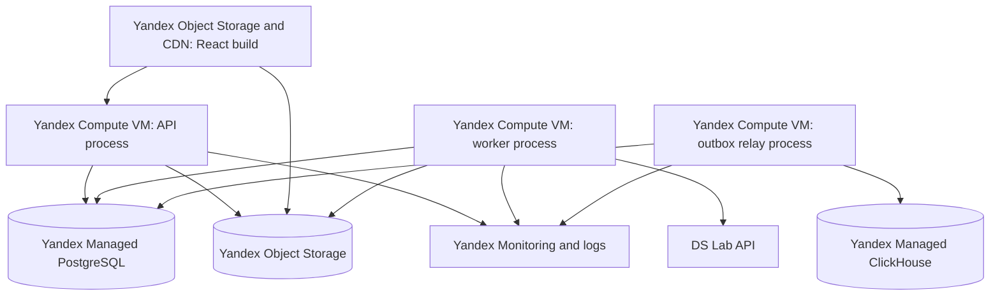

# Deployment and operations

> **Current evidence:** local backend/frontend, Alembic, Docker image and Docker Compose process manifest exist; CI and deployed Yandex Cloud resources do not. Yandex Cloud is the approved beta target, but no resource is provisioned.

## 1. Minimal deployment topology

API, worker and relay use the same immutable backend artifact and release version with different process commands. This is one modular monolith deployment, not three services with independent domain ownership. Separate processes isolate long jobs and event retries from request latency.

## 2. Environments

| Environment | Purpose | Data/dependency rule |
|---|---|---|
| Local | Development | Local/test DB, local login/password and fake/demo users only; external provider calls opt-in |
| Staging | Migration, integration, browser and recovery proof | Separate Yandex folder/resources; no local-password auth or copied production PII |
| Production | Closed beta | Least privilege, backups, alerts, approved consents/policies |

No shared database, auth identities/sessions, bucket, secret or model evaluation dataset across staging/production. Preview environments are Later; they are not worth per-branch data infrastructure for the initial team.

## 3. Configuration and secrets

Backend settings will live only in `backend/src/ai_dating/config.py`; frontend public settings only in `frontend/src/lib/env.ts`. Exact variables are created during bootstrap, but required logical settings are:

- database direct/session URL for Alembic and runtime pooled URL;
- local-password session lifetime, loopback binding and Telegram production auth credentials;
- Yandex Object Storage endpoint/bucket and service credential;
- one `DSLAB_API_KEY`, generation/embedding model versions, cost limits and timeouts. DS Lab is the only remote AI provider; missing credentials use deterministic fakes only in local/tests;
- extraction prompt/model versions, provider timeout, job lease and `extract_profile_facts` retry budget (default 3);
- ClickHouse endpoint/database/ingest credential;
- environment/release ID, CORS origins, public API URL;
- job lease/retry, activity cutoff, batch quotas and rate-limit policies.
- safe-mode switches for admissions, recommendation generation/delivery, messaging, model calls and scoped profile visibility.

All required production config fails startup. Staging/production also fail if `local_password` auth or fixed test credentials are enabled. Secrets use Yandex Lockbox, are never `VITE_*`, repository files, image layers, logs or error payloads. Rotate by overlapping credentials where provider supports it, deploy, verify, then revoke old key. Frontend receives only public API settings until a future OAuth flow is approved.

## 4. Database and migrations

Alembic is the installed local and beta schema path. A release runs exactly one reviewed migration job against the direct database connection before application promotion. API/worker startup does not auto-migrate.

Safe sequence: backward-compatible expand migration → deploy code tolerating old/new → bounded backfill job → verify counts/invariants → switch reads/writes → later contract migration. Destructive rollback is avoided; forward-fix is preferred once data shape changes. HNSW/GiST builds use online-safe method/options supported by the actual Postgres version and are tested on staging-scale data.

Release is blocked if migration revision, grants or extension versions differ from expected. Backup/restore proof precedes destructive or large backfill.

## 5. Object storage

Private buckets: original uploads, approved derivatives, restricted moderation evidence, temporary exports. Public bucket is unnecessary. API issues scoped short-lived signed URLs; upload completion verifies content before metadata activation. Lifecycle deletes abandoned intents and expired exports. Account/photo deletion queues object and derivative deletion and verifies absence after CDN/cache expiry.

## 6. Background jobs and event ingestion

DB worker claims `background_jobs` with `FOR UPDATE SKIP LOCKED`, a lease, `dedup_key`, bounded attempts and per-job timeout. The extraction worker only claims `extract_profile_facts`; unknown `job_type` values stay queued. Jobs are small: extraction, embedding, batch generation, photo processing/moderation, export/deletion. Provider calls run after the claim transaction commits. Graceful shutdown stops claiming, finishes or releases current lease before platform deadline. Local command: `uv run ai-matchmaker-worker`.

Outbox relay separately batches canonical events to ClickHouse. It never marks delivered before sink acknowledgement. Backpressure increases lag while reserved DB headroom remains. Alert at 5-minute lag; if projected outbox growth leaves <24 hours of DB headroom, throttle/disable recommendation generation and non-safety writes at the API boundary. Never commit a domain action without its required outbox event; preserve block/report/security writes from reserved capacity.

Kafka is not in MVP. Add it only at ADR-02 triggers, then use outbox/CDC → Kafka and idempotent ClickHouse consumer; dual-write remains forbidden.

## 7. Backups, restore and data recovery

- Enable provider-managed Postgres PITR/backups; beta acceptance objective is RPO ≤24 h and RTO ≤24 h, verified by a documented restore drill before the first invite.
- Object storage versioning/retention is enabled where compatible with deletion duties; a manifest makes missing derivatives rebuildable.
- ClickHouse canonical raw events can be replayed from retained Postgres outbox only for its short window, so provider backup is required; analytical marts are rebuildable from raw.
- Monthly staging restore drill proposed before beta, then quarterly after stable operation. Verify row counts, FK/check constraints, latest migration, sample media references and block enforcement.
- Recovery never republishes profiles whose consent/block/deletion state is newer than restored data without reconciliation.

## 8. Observability

Structured JSON logs include `timestamp`, `level`, `service_process`, `environment`, `release_id`, `request_id`, route/template, status/error code and duration. Never log tokens, email, DOB/location, message/profile/report text, signed URLs, prompts or raw model payloads.

Metrics:

- HTTP rate/errors/latency by route/status, DB pool/query latency;
- job queue depth/age/attempts/failures/lease expiry;
- batch generation stage latency, candidate counts, fallback mode, provider cost/limits;
- outbox depth/lag/delivery failures and ClickHouse ingest lag;
- moderation queue age/severity, block/report rate with privacy-safe aggregation;
- storage cleanup/deletion/export completion and backup freshness.

Traces cover API → DB and worker stages/provider calls using opaque entity IDs; sensitive request bodies are disabled. `request_id`, `job_id`, `event_id`, `recommendation_batch_id` support correlation under access control.

## 9. SLOs and alerts

| Signal | SLO | Page / action |
|---|---|---|
| Read API availability | 99.9% monthly | Multi-window burn alert |
| Write API availability | 99.5% monthly | Multi-window burn alert |
| Non-AI API latency | p95 <400 ms | Alert >800 ms for 15 min |
| Batch generation | p95 <30 s, 99% <60 s | Alert failure >5% or fallback >20% for 30 min |
| Outbox lag | p95 <60 s | Page >5 min for 15 min |
| Moderation severe queue | acknowledge ≤30 min; contain ≤2 h | Founder immediately enables the relevant kill switch; add backup owner before public launch |
| Safety eligibility leak | 0 | Immediate incident, disable recommendation delivery if needed |
| Deletion jobs | 99% within approved SLA | Page before SLA breach |
| Backup freshness | Within configured RPO | Page on missed backup |

## 10. Failure modes

| Failure | Behavior | Recovery |
|---|---|---|
| DS Lab unavailable/rate limited | Manual facts, cached embeddings and heuristic/exact eligible pool; new media held if moderation depends on provider | Capped retry, pin fallback; no unsafe relaxation of filters |
| ClickHouse unavailable | Domain transaction/outbox continues; analytics lag | Relay retry; protect PG with lag/storage alerts |
| Worker unavailable | API works, generation/moderation pending | Restart same artifact; leases expire safely |
| Object storage unavailable | No upload/media URL; existing text/API may work | Retry, no DB metadata promotion before object verify |
| Postgres unavailable | Fail closed; no writes/batches/messages | Provider recovery/PITR; readiness remains false |
| Bad release | Health/error/SLO canary fails | Roll back artifact; forward-fix schema if migration crossed |
| Bad model/prompt | Validation/fallback rises | Pin prior version; discard/requeue affected pending jobs |

## 11. Rollout and launch gates

Deploy staging, run migration/invariant/integration/browser checks, generate synthetic batches, test provider failures, block/report and restore. Production starts with internal/demo accounts, then a capped closed-beta cohort. Rollback is the previous immutable artifact plus feature disable of AI rerank/generation where necessary; core safety cannot be feature-flagged off.

Launch requires named owners, current runbooks, alerts routed, backup restore proof, deletion/export proof, zero hard-filter leak in test matrix, moderation coverage, tested safe-mode switches and approved jurisdiction/product TBDs. CI/CD mechanism itself is `TBD-INF03` because no CI configuration exists; do not document a command as real until bootstrap creates it.

## 12. MVP versus next stage

| MVP required | Add when triggered |
|---|---|
| API + worker + relay from one backend artifact | Separate services only for independent SLO/scale/deploy need |
| Postgres jobs/outbox | Redis/job platform or Kafka only at measured thresholds |
| Direct ClickHouse ingestion | Kafka fan-out/schema platform for multiple consumers |
| Platform-managed DB/storage backups | Cross-region DR after business RTO/RPO requires it |
| Basic telemetry backend | Dedicated data/ML platform after teams/workloads justify it |
