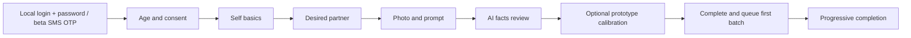
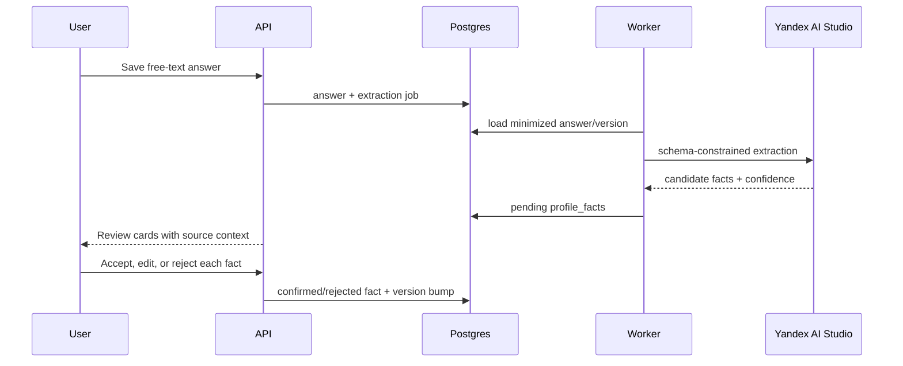

# Onboarding

> **Outcome:** за 3–5 минут собрать минимальные truthful inputs для первой безопасной подборки; остальное дозаполняется позже.

## 1. Flow

| Step | Target time | Required input | Boundary behavior |
|---|---:|---|---|
| Authentication | 30–60 s | Local `login + password` in prototype; SMS OTP in beta | Local auth refuses non-local loopback; see [authentication design](../authentication/design.md) |
| Eligibility + consent | 20–30 s | DOB, terms/privacy, AI matching consent, 21+ assertion | Beta additionally enforces 21–35; fail closed if age/consent missing |
| Self basics | 45–60 s | display name, gender, orientation, `search_mode`, dating-only relationship goal, city and coarse area | Beta is `dating` only; coarse area is restricted and never shown to candidates |
| Desired partner | 45–60 s | accepted genders, age range, dating-only accepted goals, city | Beta uses Moscow city equality; distance UI/filter remains disabled until a separate location policy |
| Profile seed | 60–90 s | ≥1 photo later; ≥1 self free-text answer and ≥1 desired-partner answer | Photo must pass moderation before visibility |
| Fact review | 30–45 s | Accept/edit/reject each extracted fact used for matching | Pending facts are not rank features |
| Calibration | 30–60 s | 3–5 synthetic demo comparisons | Prototype-only, never represented as real users/matches |

`onboarding_completed` is committed after all user-controlled required steps, even if asynchronous photo/profile moderation is pending. In that case API returns `profile_activation_pending`; recommendation generation is queued only after server-controlled activation gates pass. This keeps the 3–5 minute funnel independent from provider latency.

## 2. Completion and activation gates

Required for `onboarding_completed`:

- authenticated `account` not suspended/deleted, with DOB satisfying 21+; beta policy additionally requires age 21–35;
- current required consent receipts and `allow_ai_matching = true`;
- self: `display_name`, `gender_code`, `orientation_code`, `search_mode`, `city_code`, selected coarse `area_code`; `relationship_goal_code` when `search_mode=dating`; beta rejects `friendship`;
- desired partner: non-empty gender set, beta-valid age range, `search_mode`, `city_codes`; non-empty goal set when dating. `max_distance_km` is not a beta input or hard filter;
- at least one self answer and one desired-partner answer; the photo upload gate is a later user-controlled step and is not required for local-prototype completion;
- `facts_reviewed`: current answer versions have no queued/running extraction jobs and no active pending facts. Rejected/pending facts never affect matching. Terminal provider failure does not block completion: the user may enter allowlisted facts explicitly, while source text is retained for one later retry that creates pending suggestions and an in-app notification; those suggestions never alter matching without review;
- explicit `discoverable = true` visibility choice;
- local prototype only: `calibration_done` is `completed` or explicitly `skipped`. It is not a beta activation gate.

Additional server-controlled gates before `profile_activated` and first generation:

- at least one `approved` photo and one approved answer;
- profile moderation `approved` and server-computed completion threshold satisfied;
- current consent, account/safety state and all required embeddings or an approved fallback path.

Local prototype skips the photo gate: `POST /v1/profile/publish` activates the profile, marks moderation `approved`, and enqueues embedding jobs. This endpoint is local/demo-only and unavailable in beta, where an approved photo is required.

`POST /v1/onboarding/complete` returns `422` only for missing/invalid user-controlled inputs. Pending activation is `202 profile_activation_pending`, never `422`. Publish emits `profile_activated` and queues embeddings idempotently.

## 3. Progressive completion

Optional after first batch: additional photos (up to six), more prompts, lifestyle facts, richer free text, distance display preference and optional safety verification. Each addition has a stated purpose and visibility control. The product may nudge completion but cannot silently convert optional fields into eligibility filters.

Rank-relevant edits increment `profiles.version` or `dating_preferences.version`, invalidate stale ready batches and enqueue embeddings. Cosmetic edits that do not change public/rank projection need not regenerate embeddings.

## 4. Free text to reviewed facts

Extraction returns only allowlisted `fact_code` values and closed slugs. Confidence is model metadata, not truth. A user edit creates a new `user_edit` fact and supersedes the extracted version; provenance stays restricted for audit until its retention expires. Facts about health, ethnicity, religion, politics, sexuality beyond user-provided matching need, exact address, finances, biometrics or third parties are not inferred. Hard filters (gender, age, orientation, city, search mode, relationship goal/status, safety) are never taken from the model.

Fact review UI shows: side (`self` / `desired_partner`), normalized claim, source answer excerpt and matching purpose. Accept confirms the fact for matching (`visibility=matching_only`). No pending fact affects recommendations.

## 5. Embedding source projection

`self` embedding uses approved public/matching profile text and confirmed allowed facts. `desired_partner` embedding uses explicit preference text/facts. Projection is deterministic, ordered and versioned; it excludes DOB, exact location, account IDs, contact data, consents, blocks/reports, moderation signals and private facts. See [ai-ml.md](ai-ml.md).

## 6. Calibration

Calibration is prototype-only. It estimates soft preferences and teaches the UI, not eligibility, using only synthetic/demo personas with licensed or generated media labelled “пример, не реальный участник”.

Calibration responses are `calibration_choice` events in a separate namespace/table or payload context. They never emit canonical `like`, `pass`, `impression`, or `match`. Real-profile calibration is Later and needs separate consent/privacy/safety design.

Prototype calibration version `v1` is five server-owned text-only synthetic pairs with opaque `demo-v1-*` IDs (never account/profile UUIDs). Optional `reason_code` allowlist: `shared_interests`, `communication_style`, `activity_style`, `schedule_fit`, `other`. `complete` requires a choice for every pair and a current `calibration=granted` consent. `skip` is available immediately without that consent. Withdrawing `calibration` consent deletes choices and `signal_snapshot` and leaves a skip marker so local onboarding can complete.

Captured signals are limited to explicit comparisons and optional reason codes. They can initialize soft weights but never override hard filters. Users can skip and clear calibration data.

## 7. Drafts, retries and concurrency

- Each step saves an idempotent PATCH against an `expected_version`; stale edits return `409 version_conflict` with current state.
- Draft data is private and not discoverable. Resume loads the last committed step.
- External AI/moderation calls are jobs after commit. UI polls bounded status or refreshes; no long HTTP transaction.
- Repeated `complete` with the same idempotency key returns the same state/job.
- Completion transaction revalidates every gate; client progress percentage is never authoritative.
- If extraction fails, user can continue by entering facts explicitly. The worker retries retained source text later and creates review-only suggestions plus an in-app notification; if photo moderation is pending, onboarding stays completed while profile activation/recommendation remain pending.

## 8. Product events and funnel

Use canonical envelope and lifecycle contracts from [event-tracking.md](event-tracking.md) for `onboarding_started`, `onboarding_step_completed`, `fact_reviewed`, `calibration_completed`, `onboarding_completed`, `profile_activated` and `recommendation_generation_queued`. These are product events, not security audit. Consent decisions and age-gate changes additionally create restricted audit entries.

Activation is defined as `onboarding_completed` plus at least one delivered real `impression`, not merely account creation. Track completion and time spent per step without storing raw free text in analytics.

## 9. Failure UX acceptance criteria

- Required field error is specific and local; rejected model output never appears as confirmed truth.
- `insufficient_supply` explains that no standard-quality compatible profiles are currently available. It may offer a user-requested exploratory batch, explicitly labelled as such and still constrained by every hard safety/eligibility rule.
- Provider outage permits manual structured onboarding and heuristic generation where inputs suffice.
- Deleted/withdrawn calibration consent removes the profile from future calibration and queues deletion of retained calibration payloads.
- Accessibility basics: keyboard flow, labeled controls, error summary, no color-only status, photo alt text workflow.
