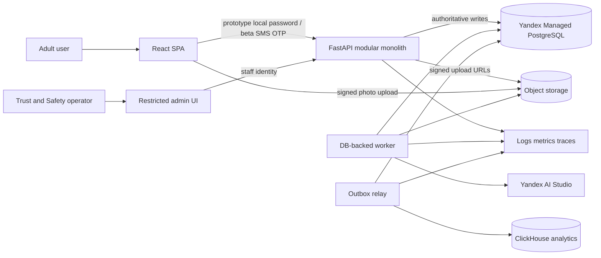
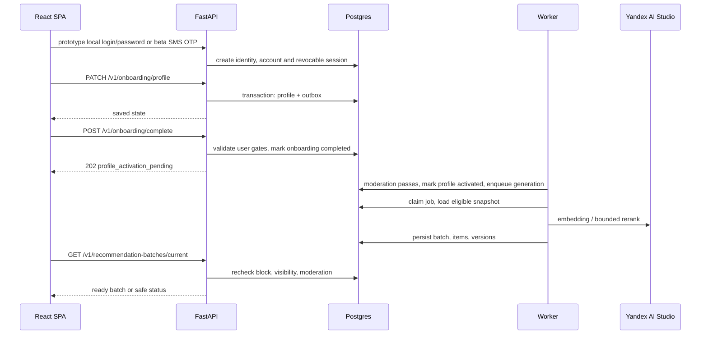

# AI Dating MVP: architecture overview

> **Status:** Local prototype implemented; closed-beta target under preparation
> **Owner:** founder (prototype); beta ownership to be confirmed
> **Updated:** 2026-08-25  
> **Scope:** implemented local prototype and target architecture for a future closed beta; production infrastructure is not deployed.

## 1. Abstract

Репозиторий содержит работающий local FastAPI/React prototype, Alembic migrations, DB-backed worker и outbox relay. Target stack зафиксирован как FastAPI, React/Vite и Yandex Cloud; CI и cloud deployment config ещё отсутствуют. Эти документы описывают текущие verified local contracts и proposed closed-beta target, а не доказательство развернутой production infrastructure.

Рекомендуемый beta target: modular monolith с одним FastAPI codebase, React SPA, Yandex Managed PostgreSQL как transactional source of truth, Object Storage для photos, DB-backed worker для recommendation и moderation jobs, Yandex AI Studio для extraction/bounded reranking и GigaChat `EmbeddingsGigaR` для retrieval. Local prototype использует application-owned `login + password` и revocable DB sessions; beta требует отдельный SMS OTP flow. Product events надёжно выходят через transactional outbox прямо в ClickHouse; Kafka добавляется только при измеримом fan-out или throughput.

## 2. Goals and non-goals

| Goals | Non-goals |
|---|---|
| Reciprocal, safety-first recommendations для узкого рынка | Infinite swipe feed |
| Первая подборка после 3–5 минут onboarding | Полноценная learned ranking platform |
| Воспроизводимый exposure и versioned AI decisions | Deterministic regeneration того же LLM текста |
| Безопасный degradation без LLM/embedding provider | Autonomous agents и действия от имени пользователя |
| События, достаточные для product evaluation и будущего ranking | Kafka и microservices без измеримой необходимости |
| Delete/export/block/report с первого дня | Social enrichment без explicit consent |

## 3. Documentation plan

Запрошенная структура сохранена. Добавлен [client brief](../client-brief.md), потому что он отделяет продуктовые решения и launch hypotheses от технических contracts. Отдельный `docs/architecture.md` не создаётся: он дублировал бы этот overview. Документы используют один glossary, API namespace `/v1`, UUID identifiers и UTC `timestamptz`.

| Document | Source of truth for |
|---|---|
| [data-model.md](data-model.md) | Transactional entities, ownership, constraints, retention |
| [recommendation-system.md](recommendation-system.md) | Eligibility, ranking, replay, fallbacks |
| [onboarding.md](onboarding.md) | 3–5-minute flow, facts review, calibration |
| [event-tracking.md](event-tracking.md) | Canonical event envelope, delivery, metrics |
| [ai-ml.md](ai-ml.md) | Model boundaries, versions, evaluation |
| [privacy-safety.md](privacy-safety.md) | Consent, visibility, deletion, moderation |
| [api.md](api.md) | Client-facing contracts and errors |
| [deployment.md](deployment.md) | Environments, jobs, observability, recovery |
| [roadmap.md](roadmap.md) | Staged delivery and revisit triggers |
| [../authentication/design.md](../authentication/design.md) | Local login/password, sessions и запрет non-local запуска |

## 4. System context

`API`, `worker` и `outbox relay` используют один backend codebase и общие domain contracts, но запускаются как отдельные processes. Это не microservices: один release, одна schema ownership и одна команда.

## 5. Critical request lifecycle

При failure до batch commit пользователь видит `generation_pending` с bounded retry. При exhausted retry job становится `failed`; API возвращает `generation_failed` и correlation id. Hard-filter или safety failure закрывается fail-closed. LLM failure даёт heuristic-only batch; embedding failure использует bounded SQL candidate pool для узкого beta market.

## 6. Components and responsibilities

| Component | Owns | Does not own | Failure behavior |
|---|---|---|---|
| React SPA | UX state, local draft, render acknowledgement | Eligibility, rank scores, consent truth | Retry safe reads; never fabricates recommendations |
| FastAPI modules | Boundary validation, authorization, domain transactions | Long-running model work, analytics queries | 5xx with request id; writes use idempotency keys |
| Postgres | Authoritative accounts, profiles, actions, matches, messages, audit/outbox | Photo binaries, analytical marts | No downstream side effect before commit |
| Object storage | Original photos and moderated derivatives | Profile truth or public visibility decision | Photo remains non-public until approved derivative exists |
| DB-backed worker | Extraction, embeddings, recommendation jobs, moderation calls | HTTP auth boundary | Lease + retry; idempotent commit by job/dedup key |
| Yandex AI Studio | Bounded extraction and reranking | Final eligibility, consent, enforcement | Timeouts and circuit breaker; local fallback |
| GigaChat `EmbeddingsGigaR` | 2560-dimensional retrieval embeddings | Final eligibility, consent, enforcement | Exact eligible SQL + heuristic |
| Outbox relay | At-least-once delivery to analytics | Domain state mutation | Retries with backoff; dedup by `event_id` |
| ClickHouse | Product event log and analytical marts | Transactional truth, security enforcement | Analytics may lag; user write path remains available |

## 7. Data categories

| Category | Examples | Authority |
|---|---|---|
| Authoritative transactional | `accounts`, `profiles`, `dating_preferences`, `blocks`, `matches`, `messages`, consents | Postgres |
| Derived operational | `profile_facts` extracted by AI until confirmed, `profile_embeddings`, rank scores, reasons | Rebuildable from versioned source snapshots where permitted |
| Event log | Canonical product event envelope | ClickHouse raw append table after outbox delivery |
| Security audit | Consent changes, staff access, block/report/moderation transitions | Append-only Postgres audit table with restricted access |
| Analytical marts | Funnels, supply coverage, safety rates | ClickHouse, rebuildable from canonical events |
| Media | Photo objects and derivatives | Object storage; Postgres metadata controls visibility |

## 8. Invariants

- `INV-1`: eligibility, block, visibility and moderation rules run before ranking and again before delivery.
- `INV-2`: client input cannot set rank scores, recommendation reasons, model versions, moderation state or actor identifiers.
- `INV-3`: every real impression references a persisted batch/item snapshot and is idempotent.
- `INV-9`: delivery serializes the persisted public profile snapshot only when its candidate profile version is still current; stale items are omitted/refilled.
- `INV-4`: an account never sees a previously impressed candidate under MVP policy.
- `INV-5`: matching is created exactly once from two active reciprocal likes.
- `INV-6`: block hides both directions immediately; analytics lag cannot weaken enforcement.
- `INV-7`: private/hidden facts never appear in public payloads or recommendation reasons.
- `INV-8`: external calls do not occur inside a database transaction and cannot precede required durable intent.

## 9. ADR-like decisions

### ADR-01: modular monolith

**Decision:** один FastAPI codebase и одна Postgres schema, с отдельными API/worker/relay processes. **Rejected:** отдельные profile, matching, messaging и recommendation services. **Trade-off:** release coupling и shared DB, зато нет distributed transactions и duplicated policy logic. **Revisit:** разные modules требуют независимых deploy cadence/SLO или один workload не масштабируется изоляцией processes.

### ADR-02: Postgres outbox, direct ClickHouse, no Kafka in early MVP

**Decision:** domain transaction добавляет canonical event в `outbox_events`; relay доставляет JSONEachRow в ClickHouse at least once. **Rejected:** dual-write и Kafka с первого дня. **Trade-off:** один consumer path и Postgres polling overhead, зато меньше infrastructure. **Revisit:** устойчиво >100 events/s, >3 independent consumers, relay lag >60 s при нормальной DB load, либо нужен ordered replay нескольким consumers.

### ADR-03: HNSW cosine index for profile embeddings

**Decision:** `pgvector` HNSW cosine index, retrieval только внутри предварительно отфильтрованного eligible set. **Rejected:** IVFFlat на старте и external vector DB. **Trade-off:** HNSW требует больше memory/build time, но не требует trained lists и даёт хороший cold-start recall. **Revisit:** index не помещается в memory, write amplification мешает profile updates или measured recall/latency не держат budget.

### ADR-04: DB-backed jobs

**Decision:** `background_jobs` с `FOR UPDATE SKIP LOCKED`, lease и bounded retries. **Rejected:** Celery/Redis/Kafka jobs. **Trade-off:** Postgres принимает polling/queue load; для beta это проще и транзакционно согласовано. **Revisit:** queue depth >100k, claim latency p95 >1 s, sustained >20 jobs/s или workload начинает вредить OLTP.

### ADR-05: bounded LLM reranking is optional for availability

**Decision:** LLM видит до 20 minimized candidate summaries и может только reorder eligible IDs; heuristic result сохраняется как fallback. **Rejected:** LLM candidate generation или free-form selection. **Trade-off:** меньше semantic flexibility, зато hard safety boundary, cost ceiling и explainable degradation. **Revisit:** offline/online evaluation не показывает incremental quality либо стоимость превышает `TBD-ML02`.

## 10. Operational targets

Все значения являются initial engineering budgets и уточняются после beta traffic.

| Signal | Target / alert | Launch gate |
|---|---|---|
| Read API availability | 99.9% monthly | Required |
| Write API availability | 99.5% monthly | Required |
| Non-AI API latency | p95 < 400 ms | Required |
| Current batch read | p95 < 500 ms | Required |
| Batch generation | p95 < 30 s, hard deadline 60 s | Required |
| Outbox lag | p95 < 60 s; alert at 5 min for 15 min | Required |
| Safety exclusion leak | 0; page immediately | Required |
| Recommendation fallback rate | warning >20% for 30 min | Recommended |

## 11. Assumptions and open questions

- **Decision:** Yandex Cloud is the target production data plane; no deployed resources were found.
- **Decision:** Yandex Managed PostgreSQL supports `pgvector` and PostGIS. Exact extension versions and index behavior are verified in a disposable cluster before migrations are finalized.
- **Decision:** founder owns product, platform, CI/CD, Trust & Safety and incident response for prototype.
- **Decision:** target segment, taxonomy and location semantics are fixed in [client brief](../client-brief.md).
- **Decision:** GigaChat `EmbeddingsGigaR` provides `vector(2560)` retrieval embeddings; Yandex AI Studio remains the generation provider.
- **Closed-beta gate:** jurisdiction-specific retention, employee access/encryption posture, safety SLA/backup owner, production SMS OTP/provider, model/auth budgets and restore proof remain unresolved. They do not block local prototype work.

## 12. Decision and next step

Рекомендуется утвердить product blocking decisions, затем bootstrap только foundation из [roadmap](roadmap.md). Kafka, microservices, learned ranking и social enrichment сознательно не проектируются как MVP dependencies.
