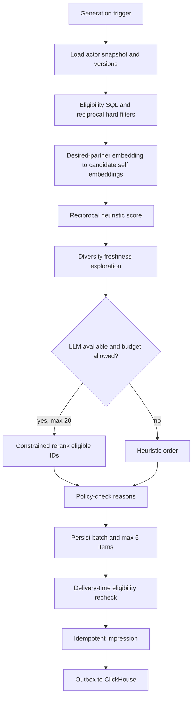
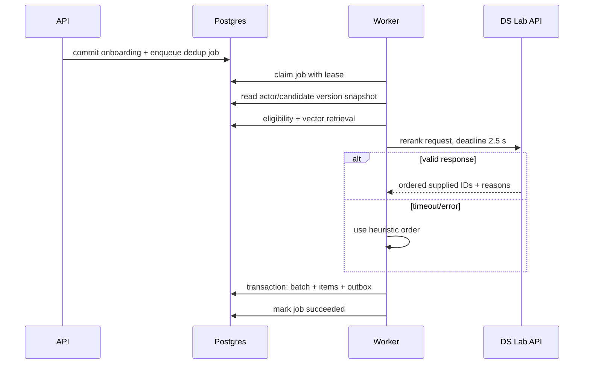

# Recommendation system v0

> **Goal:** до пяти новых, взаимно eligible кандидатов; hard safety rules важнее relevance.  
> **Owner:** backend recommendation module; final enforcement remains in API delivery path.

## 1. End-to-end flow



Trigger occurs after onboarding completion, relevant profile/preference update, batch expiry or full consumption. Beta permits two successful normal batches per calendar day; `quota_slot=2` is assigned only after every item in slot 1 has a terminal `like|pass` action. A unique `generation_key = account_id:profile_version:preferences_version:policy_version:date:quota_slot:batch_kind` makes retries converge on one batch. An exploratory batch is separately user-requested after `insufficient_supply`; it never consumes or bypasses the normal safety policy.

## 2. Stage contracts

### 2.1 Eligibility and hard filters

The initial SQL excludes before any model call:

1. self, deleted/suspended/paused accounts, profiles not `eligible + approved`, photos without at least one approved image;
2. activity older than 30 days (**Assumption**, product-configured policy version);
3. either-direction active block, report-triggered block, safety suspension;
4. prior `recommendation_exposures` for the actor/candidate pair;
5. incompatible age ranges in both directions;
6. incompatible `accepted_gender_codes` in both directions; orientation labels never substitute for explicit desired-gender intent;
7. beta requires `search_mode=dating`, relationship-goal intersection in both directions and `city_code` ∈ `city_codes` in both directions; `friendship` remains local-prototype-only;
8. beta uses Moscow city equality only; no client-visible distance or `max_distance_km` filter is applied until a separate location policy approves it;
9. actor/candidate without required consent, visibility or onboarding gates.

Eligibility produces candidate IDs plus versioned, minimized rank features. It never returns private fact values to the client or LLM unless explicitly allowed for matching.

The same policy is run again immediately before API delivery. If an item is now ineligible, it is omitted and a refill job is queued; it is never replaced client-side.

### 2.2 Embedding retrieval

The actor's `desired_partner` embedding is compared by cosine distance with candidates' current `self` embeddings. MVP uses DS Lab `gte-base` (`vector(768)`); `model_version` and `projection_schema_version` are part of every embedding cache key. HNSW is selected because beta has frequent updates and no trained IVFFlat lists. Query oversamples to 100 candidates, then retains at most 50 after current-version and reciprocal checks.

Filtered ANN can return too few rows because an HNSW scan may encounter ineligible neighbors. The implementation must measure eligible recall against an exact-search sample. For small pools (<5,000 eligible rows), exact cosine over the eligible set is an acceptable fallback and often simpler. HNSW settings are tuned only from `EXPLAIN` and recall evidence.

### 2.3 Reciprocal heuristic

All components are normalized to `[0,1]`. Example v0:

```text
score(a, c) = 0.30 * semantic(a.desired, c.self)
            + 0.20 * semantic(c.desired, a.self)
            + 0.15 * goal_alignment(a, c)
            + 0.10 * prompt_fact_overlap(a, c)
            + 0.10 * distance_decay(a, c)
            + 0.10 * activity_freshness(c)
            + 0.05 * profile_quality(c)
```

```python
eligible = reciprocal_hard_filters(actor)
candidates = embedding_retrieve(actor.desired_embedding, eligible, limit=100)
scored = [(c, reciprocal_score(actor, c)) for c in candidates]
pool = diversify(scored, limit=20)
result = llm_rerank(pool) if llm_budget_available() else pool
persist(result[:5])
```

`profile_quality` rewards completion/approved content, not protected or attractiveness proxies. No score may compensate for failed hard filter. Weights and feature transforms are stored as `ranker_version`, not remotely mutable mid-job.

### 2.4 Diversity and exploratory batches

- Greedy selection penalizes near-duplicate embedding clusters and repeated prompt/fact themes within one batch.
- Normal beta batches contain no exploration slot.
- After `insufficient_supply`, the user may explicitly request a separately labelled exploratory batch. It samples only from the fully reciprocal-eligible, no-repeat pool and relaxes only the normal ranking threshold.
- New/low-exposure candidates receive a capped freshness bonus; no permanent popularity feedback loop.
- Experiment assignment is server-side, stable and copied into batch/event snapshots.

### 2.5 Bounded LLM reranker

The model receives actor preference summary and up to 20 candidate summaries containing only policy-approved matching fields. It must return a JSON list of supplied candidate IDs plus reason codes. Server validation rejects unknown/duplicate IDs, missing eligible IDs, prohibited reason fields or malformed output.

LLM can reorder and explain; it cannot add candidates, change eligibility or write user facts. On timeout, provider error, rate limit, invalid JSON or policy failure, the heuristic order is persisted with `fallback_mode = no_llm`.

## 3. Generation sequence and concurrency



One active generation job per `generation_key`. Lease expiry permits another worker to retry. Batch commit uses the same `generation_key` uniqueness, so duplicate external calls cannot duplicate batches. Source version drift before commit aborts the result and queues a fresh key; a job never mixes profile versions.

## 4. Batch persistence, exposure and replay

`recommendation_batches.input_snapshot` stores actor/profile/preference versions, candidate IDs considered, batch kind, feature schema version and policy versions. `batch_schema_version` and each `item_schema_version` version the persisted/delivered contract. Items store component scores, final order, candidate profile/embedding versions, a minimized `public_profile_snapshot` and approved reason snapshot.

Deterministic replay means an operator can reconstruct why stored inputs produced the saved order. It does **not** promise that calling a hosted LLM again returns byte-identical output. Runtime raw model request/response is not retained; only consented evaluation samples may be stored under the separate AI retention policy. Public delivery uses the persisted reason snapshot.

Delivery never joins live display fields into a stored item. It rechecks current eligibility/safety and requires exact `candidate_profile_version`; if the version changed, the item is omitted and refill is queued. Otherwise API serializes the stored public snapshot and creates fresh signed URLs only for photo IDs that remain approved. Deletion/withdrawal erases snapshot content according to privacy policy, so post-erasure replay proves versions/actions but intentionally cannot reconstruct deleted personal content.

`POST /v1/recommendation-items/{id}/impression` atomically inserts `recommendation_exposures` and emits `impression`. Repeated requests, even with a new idempotency key, return the existing exposure without a second event. Unique `(owner_account_id,candidate_account_id)` prevents future exposure across batches. An item generated but never impressed is not history and can remain in the current batch until expiry.

## 5. Guards

- Recheck `INV-1` at generation and delivery; block/report writes invalidate ready items both directions.
- Validate candidate ID ownership and batch owner on every feedback action.
- Client cannot submit scores, reason, actor ID, subject ID or event timestamps.
- Explanation allowlist excludes exact location, orientation unless visible, private facts, moderation signals and inferred sensitive traits.
- Under 18, incomplete consent or ambiguous location fails closed.
- Bounded candidate/input tokens, provider timeout and per-account/day generation quota cap cost.
- Rate limit batch refresh; consuming/passing all items does not create an infinite feed.

## 6. Fallbacks and user-visible behavior

| Failure | Safe fallback | User sees |
|---|---|---|
| LLM unavailable/invalid | Heuristic-only batch | Normal batch; no provider detail |
| Actor embedding missing | Exact hard-filter pool; renormalize score over available non-semantic components and enqueue embedding | Smaller/degraded batch if at least 1 candidate |
| Candidate embeddings sparse | Mix vector results with eligible SQL pool | Normal or smaller batch |
| PostGIS unavailable | No generation unless one-city equality policy approved | `generation_failed`, not approximate distance |
| Insufficient eligible supply | Persist `insufficient_supply`; recheck on eligible cohort activation and at most daily as fallback | Honest waitlist message and an optional user-requested exploratory batch; never loosen hard filters |
| Postgres unavailable | No batch generation/delivery | Retryable service error |
| Version changes mid-job | Discard output, enqueue current version | `generation_pending` |
| Delivery recheck removes item | Omit item, enqueue refill | Smaller batch; never stale unsafe card |

## 7. Budgets and caching

| Budget | Initial target |
|---|---:|
| Eligibility + retrieval | p95 ≤ 500 ms |
| Heuristic + diversity | p95 ≤ 100 ms |
| LLM call | p95 ≤ 2.5 s, hard timeout 3 s |
| Whole batch worker time | p95 ≤ 30 s including queue, deadline 60 s |
| LLM candidates | ≤20 |
| Batch size | 1–5 |
| Batch lifetime | 24 h, full terminal consumption, or profile/preferences version change |
| Generation quota | 2 successful normal batches/account/day; slot 2 only after slot 1 is fully consumed |
| Model cost | `TBD-ML02`; enforced per batch and daily global cap |

Postgres batch rows are the cache. No Redis in MVP. Embeddings cache by `(profile_id, kind, source_version, model_version)`. `insufficient_supply` is invalidated by eligible cohort activation or once-daily fallback recheck; an operator may invalidate it after a controlled supply import.

## 8. Feedback loop and metrics

Canonical feedback: `impression`, `open`, `like`, `pass`, optional `pass_reason`, `match`, `message`, `reply`, `unmatch`, `block`, `report`. Training/evaluation joins only by pseudonymous IDs and stored batch/item versions. Counterfactual data is limited: non-impressed candidates are not treated as negatives, and pass is weaker than block/report.

Offline evaluation after enough data: hard-filter violation rate (must be zero), eligible recall@100, reciprocal outcomes, reply within 48 h, conversation depth, unmatch/block/report rates, diversity and supply fairness. Online experiments use guardrails and stable assignments; like-rate improvement alone cannot promote a ranker.

## 9. MVP versus learned ranking

| MVP v0 | Later, only after data gate |
|---|---|
| Hand-authored transparent features/weights | Pairwise/listwise learned score |
| Postgres feature reads | Offline feature pipeline; feature store only if online consistency requires it |
| One bounded LLM rerank | Distilled/learned reranker if quality-cost proof exists |
| No exploration in normal beta batches | Calibrated exploration policy after sufficient safe data |
| Manual evaluation set + product outcomes | Bias-aware offline datasets, shadow evaluation, model registry |

Promotion gate for learned ranking: sufficient consented events, stable event semantics, leakage audit, offline gain on reply/safety-aware target, shadow test, rollback path and no worse safety guardrails.
