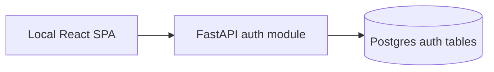

# Local prototype authentication

> **Status:** Decided for local prototype. Phone OTP/call-code and Yandex ID are Later, before real-user closed beta.

## 1. Executive summary

Для local prototype пользователь создаёт `login + password`; backend создаёт application account и выдаёт revocable opaque session. Это даёт настоящий actor boundary для onboarding, blocks и events без SMS provider, Yandex ID или обработки реальных phone numbers. Минус: этот способ не подтверждает номер, возраст или личность и поэтому запрещён вне local development.

## 2. Context and scope

Этот документ заменяет прежний passwordless flow только для `APP_ENV=local`. Локальный запуск может создавать несколько test accounts, чтобы проверить взаимные действия. Phone OTP/call-code, SMS exemptions, Yandex ID, invite login и password reset не реализуются в prototype и требуют отдельного closed-beta design.

## 3. System context

Backend устанавливает identity и session. SPA передаёт credentials только через local API; password не передаётся в analytics, logs, LLM или events.

## 4. Proposed design

### How it works

`POST /v1/auth/local/register` принимает нормализованный `login` и password, создаёт `accounts`, local identity, password credential и session в одной transaction. `POST /v1/auth/local/sessions` проверяет credentials и создаёт новую session. Все domain endpoints получают actor только из непросроченной и неотозванной session. `DELETE /v1/auth/sessions/current` отзывает её.

### Components and responsibilities

- `auth` module владеет local credentials, sessions и actor lookup; он не владеет profile, consent или authorization чужих ресурсов.
- `auth_identities` хранит уникальный normalised login как `provider=local_password`; `auth_password_credentials` хранит только password hash.
- `auth_sessions` хранит hash opaque session token. Клиент получает исходный token только в register/login response. Prototype SPA держит его в памяти и дублирует в `localStorage` при Keep me signed in, иначе в `sessionStorage`; logout и `401` очищают оба хранилища.

### Decisions

Выбран local login/password вместо SMS stub: он проверяет реальный account/session boundary и позволяет вручную создать несколько тестовых пользователей. Password hash uses Argon2id. Не выбран фиксированный общий test code: он не проверяет изоляцию accounts и легко становится скрытым bypass. Не выбран email/password: email не нужен для local prototype и добавляет ненужную PII/verification surface.

## 5. Invariants and requirements

### Invariants

- `INV-AUTH-1`: `local_password` authentication is accepted only when `APP_ENV=local` and server binds loopback; startup fails otherwise.
- `INV-AUTH-2`: plaintext password never reaches a database, log, event, audit record or response; only Argon2id hash is stored.
- `INV-AUTH-3`: active session identifies exactly one non-deleted account; DB stores session token only as a hash.
- `INV-AUTH-4`: login failure never tells whether the login exists; it returns generic `invalid_credentials`.
- `INV-AUTH-5`: a client never supplies `account_id`, actor or session owner to a domain endpoint.

### Requirements

- `login` is lowercase ASCII matching `^[a-z0-9][a-z0-9._-]*$`; it is unique after normalisation.
- Password must be non-empty. Server rejects blank and malformed JSON fields.
- Sessions expire after the local configurable lifetime (default 24 hours); logout, block and deletion can revoke them immediately.
- Local server binds `127.0.0.1` by default. It must not be exposed through a tunnel or shared environment while local-password mode is enabled.

## 6. Interfaces and data

| Endpoint | Auth / idempotency | Contract |
|---|---|---|
| `POST /v1/auth/local/register` | Public, local only, `Idempotency-Key` | `{login,password}`; returns `{account_id,session_token,expires_at}`. Duplicate login returns `409 login_unavailable`. |
| `POST /v1/auth/local/sessions` | Public, local only, `Idempotency-Key` | `{login,password}`; returns a fresh opaque session or generic `401 invalid_credentials`. |
| `DELETE /v1/auth/sessions/current` | Current session + idempotency | Revokes current session and returns `204`. |

Tables:

- `auth_identities(identity_id, account_id, provider, provider_subject, verified_at, created_at)`, unique `(provider, provider_subject)`; current provider is only `local_password`.
- `auth_password_credentials(account_id PK/FK, password_hash, password_changed_at, created_at)`; no password history or recovery token in prototype.
- `auth_sessions(session_id, account_id, token_hash, expires_at, revoked_at, created_at)`.

`account_id`, identity ID and session ID are server-generated UUIDs. Changing login/password and password reset are not supported; recreate a local test account instead.

## 7. Failure behavior and lifecycle

Invalid credentials return `401`; expired/revoked session returns `401 unauthenticated`. Duplicate registration returns `409` because this local UI is a test-account tool. If database write fails, no account, credential or session is committed. On restart sessions remain valid until expiry/revocation because they are DB-backed.

Changing `APP_ENV` from local to staging/production with local-password auth enabled is a startup error. There is no migration path from a local credential into future phone/Yandex identity; real-user closed beta starts with a distinct approved auth flow.

## 8. Security, privacy, and operations

Passwords use Argon2id with library-managed current parameters and per-password salt. Test logins are identifiers and are not sent to ClickHouse or model providers. TLS is not required for a loopback-only local server; any non-loopback deployment is forbidden by `INV-AUTH-1`, not merely discouraged.

No production secrets or hard-coded test credentials are committed. A developer may create accounts through the local register screen/API; fixture accounts, if later needed, use a test-only database and are never enabled by default.

## 9. Acceptance criteria

- `AC-AUTH-1`: registration stores an Argon2id hash, creates one account/identity/session transactionally and never returns a password hash.
- `AC-AUTH-2`: valid login returns a session; invalid and unknown login both return identical `401 invalid_credentials` response shape.
- `AC-AUTH-3`: a session of one local account cannot read or alter another account's resource.
- `AC-AUTH-4`: logout/revocation/expiry prevent further authenticated calls.
- `AC-AUTH-5`: local-password configuration refuses non-local environment or non-loopback binding.

## 10. Test approach

Unit tests cover login normalisation, password validation and `INV-AUTH-2`. Integration tests cover registration rollback, login enumeration resistance, session revocation and `AC-AUTH-3..5`. The SPA is manually checked in the browser according to `frontend/AGENTS.md`; no frontend test runner is added.

## 11. Risks and tradeoffs

- Local credentials are weaker than verified phone identity. Mitigation: no real users, no public exposure and explicit startup guard.
- Password implementation adds hashing code. Mitigation: use one established Argon2id library instead of custom crypto.
- Test accounts are not portable to beta. Mitigation: treat local DB as disposable and do not promise migration.

## 12. Open questions

- **Not blocking prototype:** choose phone/SMS provider, Yandex ID and exemption policy for closed beta (`TBD-AUTH03`).
- **Not blocking prototype:** choose production auth budget (`TBD-AUTH02`).

## 13. Out of scope

- Phone OTP/call-code, SMS provider, Yandex ID, invitations, MFA, password reset/change, email verification, staff UI and any hosted/public local-password environment.
